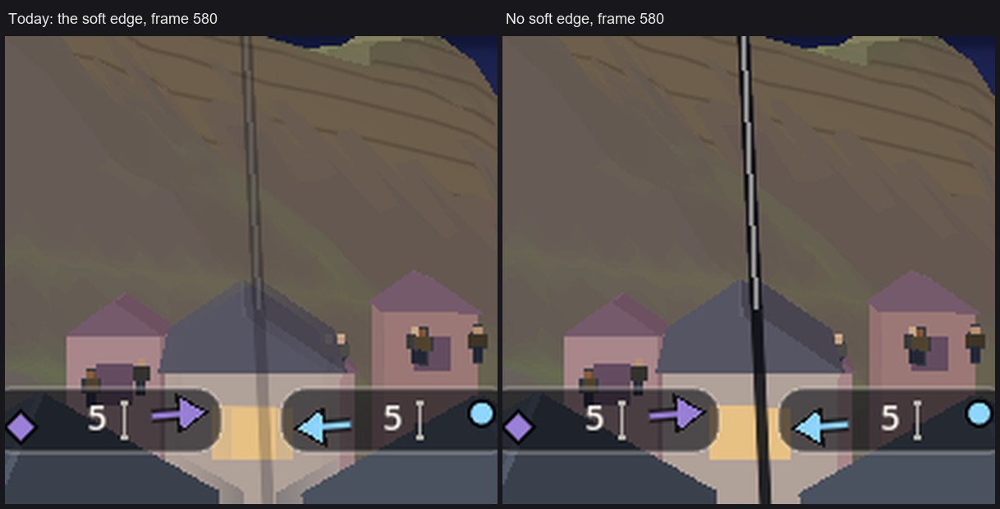
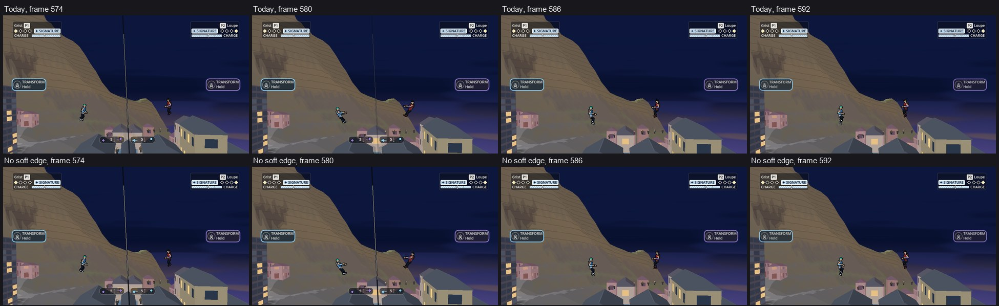
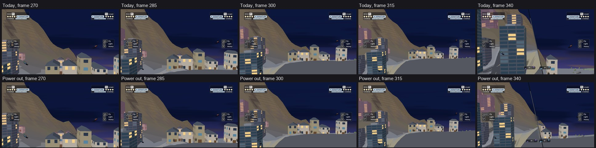

# How split screen should work: a proposal for Orb (Camera, 2026-11-01)

Orb asked to "define the vision for the way split screen will be handled" (`docs/ep/vision.md`, last paragraph). **This is a proposal, and it's yours to mark.** Only the merge's fix and one small switch are built, parked and off. Couch 2v2 and two-PC play are paper.

## The vision in five lines

1. **Your screen is your fight.** You see you and your own opponent. Nobody else's fight moves your camera.
2. **One picture for as long as it reads.** The screen splits only when zooming out further would make the fighters too small, which is your rule of 2026-09-29.
3. **Never more than two panes,** even in 2v2.
4. **A friend's big moment reaches you through the world, the map and their voice,** not through a window on your screen.
5. **Two panes become one by easing together, or by the slam on contact. Never a dissolve.**

## Who sees what

| Who's playing | What's on the screen | Built? |
| :--- | :--- | :--- |
| **One player against the computer** | One picture, splitting when you fly far apart. It stays your choice in Settings ("Split screen against the computer" is on by default; off, one camera stays on your fighter, with an edge pointer and the ring map for your rival) | Yes, today |
| **Two players on one screen** | One picture while everyone reads, otherwise two panes. In 2v2 each player gets one pane, with their own opponent in it | 1v1 yes. 2v2 no |
| **Two PCs on your network** | Each PC has its own camera on its own fight, so the two screens can differ. Split only for you and your opponent | No. About half a session of camera work, on top of the 18 to 24 sessions in `docs/net/two-v-two-lan.md` |
| **Your friend, on the other PC** | When they're in your frame, you just see them. When they're not, a small chip at the screen's edge and a mark on the ring map | The chip and the map exist for one rival. Showing a partner: no |

## Today's merge has a dissolve, and it should go

Two panes close by sliding together. Today, the edge between them goes soft as they do, so for about half a second the two pictures blend across a band. You said no dissolves on 2026-10-18. Earlier, on 2026-09-29, your notes asked for "a dissolve when flying back together", so I'm treating the later word as the one that stands.

*Real frames from the game, with the flight staged. Left, today: houses and the distance chips show through each other around a ghost of a line. Right, with the fix: a hard edge and a whole line, until the two pictures are one.*

**How bad it gets.** I measured real computer-against-computer fights: at its worst the blend is 82 pixels wide at 1280 across, with the two pictures still 336 pixels apart. That's the frame above at its roughest, and it's on for about 203 of every 224 merging ticks.

**The fix.** The line stays whole until the two pictures match (at most 0.3 pixels apart in the test), then goes in one frame. Nothing fades. **What to look for:** the line is plainer and harder than the soft version for that half second, and it's a dark stroke over whatever's behind it. It's my recommendation, but your eye decides.

**The opening** used the same soft edge, in reverse, and the fix covers it too.

## Should power change when the screen splits?

The first idea was: at low power stay close and split early; with both at peak, hold the wide planet shot and split late. **I tested it, and I'm against both halves.** The stand-in has since withdrawn it too.

| Rule, in 4 computer fights of 90 s each | Time in two panes | Splits a minute | Apart when it splits (units) |
| :--- | :--- | :--- | :--- |
| Today, real power | 7.7% | 2.5 | 1,953 |
| Split early at low power | 9.0% | 3.2 | 1,837 |
| Today, both held at top power | 5.3% | 2.7 | 1,295 |
| Peak rule, both held at top power | 3.7% | 2.2 | 1,333 |
| Power taken out of the choice, both held at top power | 4.9% | 2.5 | 1,303 |

- **Split early at low power goes the wrong way.** It's more panes in the ordinary fight, and your friend's note was that they'd like it to stay wide longer.
- **The peak rule can't hold a wide shot.** Moving the line lets the pair get 2,587 units apart instead of 1,538, before the fighters fall to 26 pixels at 720p. At top flight speed, 10,000 units a second, that's **a tenth of a second more**.
- **It also barely touches real fights.** With both at top power, no split in those fights opened on the size line at all. They opened because a fighter left the frame (4 times) or a launch ended (8 times).
- **The computer never reached it.** In those fights, both fighters were at power 3 or above for none of the 6 minutes, so the rule wouldn't have fired without a forced test.
- **26 pixels is small,** and you've already told us fighters seemed too small.

**Where the wide planet view comes from instead:** the shots made for it. The launch's peak shot, and a long flight opening out in its middle (`launch-director.md`). Both already run on a fighter you can follow.

**One thing is true, though small:** today, high power brings the split sooner, 1,538 units against 1,974, because power widens the picture and the split reads the picture's size. I've built a switch that takes power out of that choice, so the split comes at the same distance at any power. It's off.

*Real frames, staged flight, both at top power. Top, today; bottom, with the switch. It splits a little later. At that point the fighters are about 33 pixels at 720p instead of 40.*

**My recommendation: leave it off.** It costs fighter size and hardly changes a fight. Look again once fights really reach top power.

## A friend's big moment

**No corner window by default.** I agree with the stand-in's second thought. The corner window was close to your rule of nothing over the fighters, and the inset I've parked has a Legal condition: it frames a building, never people. Your own words for it were about a beam on a skyscraper.

What carries a friend's big moment instead: **their voice line, the mark on the map, and the world itself,** with their trail across your sky and the landing shaking your ground by distance. If a window is ever wanted, I'd offer it only on request, only after a rescue has been played, and only with a fresh Legal read. It would have to:

- open only in a corner with no fighter in it, and none headed there in the next half second;
- not open at all if no corner is free;
- close instead of moving;
- never appear during a blow.

That's paper: I haven't tested it.

## Where this could look bad

- **Couch 2v2:** two panes hold two fights, so each is half the screen with its own pair. Nobody's tried it, and it may feel busy.
- **A friend off-screen for long stretches** could feel like playing alone. The chip and the map may not be enough. It needs playing, not more paper.
- **The hard line:** see above.
- **Nothing here has been played with a pad.** The pictures are stills from a staged flight; the numbers are computer fights.

## After the first play

You found 50/50 uncomfortable at high speed and suggested about 70/30 against a CPU. **So "who sees what" changes for one player against the computer:** the split is 70/30 in your favour once that's marked. Two players on one screen stay even, and each PC on a network has its own 70/30. The ideas and pictures: `split-unequal.md`.

## Marks wanted from Orb

1. **The merge:** hard edge, as on the right above? Yes, or tell me what's wrong with it.
2. **Your screen is your fight, on two PCs:** is that right, or do you want to see more of your friend?
3. **Two panes at most on a couch, even in 2v2:** yes or no?

## For the team

- **Parks:** `pending/split-vision/split-vision.patch` holds `SplitRig.eased_merge` and `SplitRig.split_ignores_power`, both off, with `render/camera/tests/split_vision_check.gd`. `pending/split-vision/cut-dissolve-gone.patch` removes the unused cut dissolve (Legal's RL-229). README there.
- **Checks:** off, `clip_digest` and `split_sweep` are identical. `eased_merge` on, `split_sweep` passes. Look gate: the frames above are the side-by-side.
- **Flash:** not run, per the backburner ruling. Public check later.
- **2v2 camera notes:** `two-v-two.md`, `one-v-many.md`.
