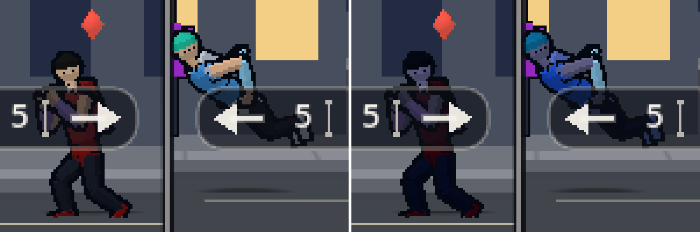

# The body's tint, and a lane colour changed in place (2026-10-11)

Two small pieces ahead of the world's light (`dynamic-sky.md`). Neither changes a pixel of the default look.

## The body's tint (not driven yet)

- **What.** `render/shaders/fighter_body.gdshader` has Animation's `tint` uniform (`docs/animation/handoff/body-tint-shader.patch`, applied on the shader as it stands, with the hit tint's `hit_mix` kept): one multiply on the body's own colours, after the damage marks.
- **The mask is the mesh's vertex alpha:** 1 on the body, 0 on the lane colour's parts (forearms and sashes), which are never tinted.
- **Never tinted:** the outline (another pass), the aura, every glow, and the hit flash (`AnimBody` draws the body untinted for the ticks it flashes; the hit tint mixes toward white after the multiply).
- **White unless set.** Nothing calls `AnimBody.set_tint` yet. Rendering will set it each frame from the sky's value when Art's colours arrive.
- **Checked on the web build** (headless Godot compiles no shaders): with the tint white, frames of the mash clip are the same to the pixel with and without the patch (ticks 100, 160, 220, 280, 340 and 400, export of 2e0f3b2c).
- **The mask, in a scratch build** with a blue tint as the shader's default (left as shipped, right tinted). Skin, hair and clothes take it; the red and cyan lane parts and the keyline keep their colour: 

## A lane colour changed in place

- **Before:** when UI's lane colours changed (a colour-blind preset), every pane's fighter views were freed and built again in the new colour.
- **Now** the same views take it: `FighterView.set_lane` sets the view's aura colour and the charge orb's glow, and hands the body the palette with the new accent through Animation's `AnimBody.set_palette` (the cached mesh of that palette; the skin and the bones stay). The aura, the streaks, the cue flare and the guard arc take the colour as they are drawn.
- **Why it matters:** a pose, a flash in flight and the view's hooks carry on across a change, and nothing is allocated for one.
- **Check:** `tools/lane_check.gd` (10 checks) now asserts the views are the same objects under each preset and off again, that the body wears the palette with the lane colour as its accent, and that the orb's glow is in it.
- **To follow once the after-image batch is committed:** `README.md` still says the views are built again (its paragraph on the colour-blind presets, and the lane check's row). It was reported in that batch and is frozen; the two sentences change after the commit.
