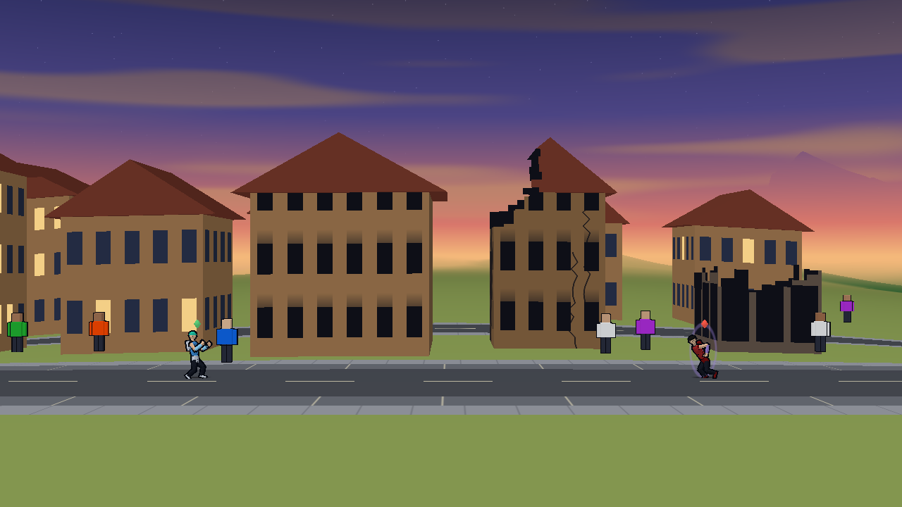
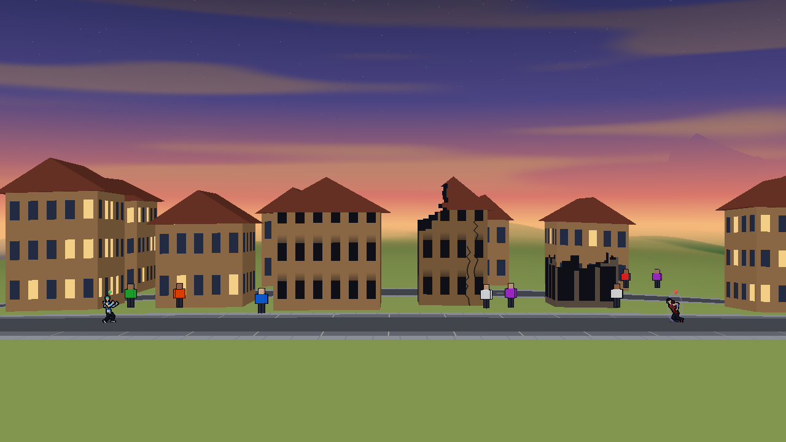
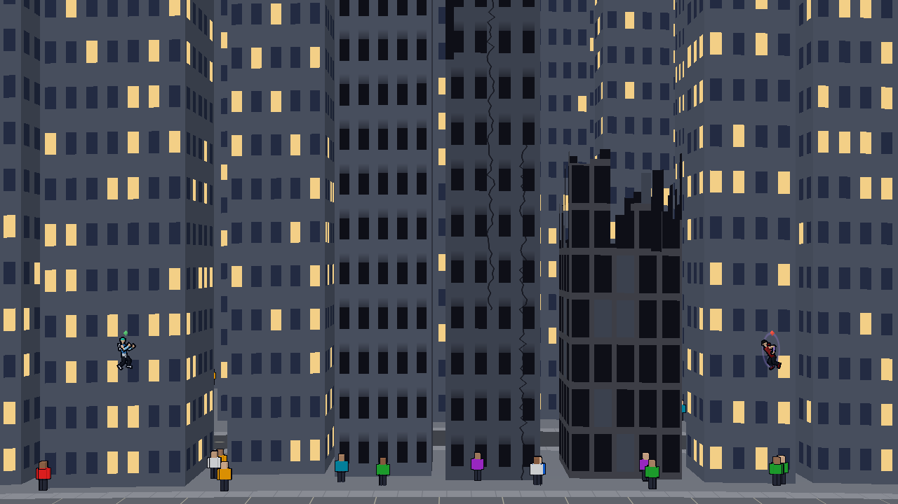
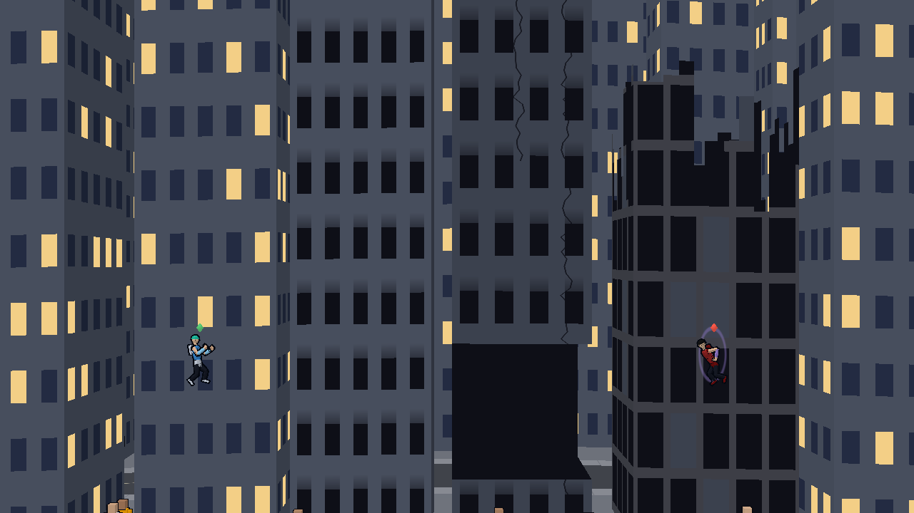
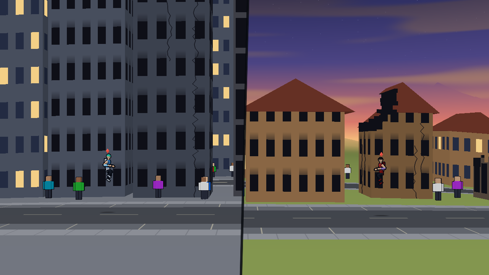

# Buildings by damage stage

Owner: Rendering and Technical Art. Status: built 2026-10-04, for World's staged destruction (`docs/world/staged-destruction.md`, sections 2, 9 and 10). VFX's effects at each change of stage (`render/vfx/stages.gd`) are drawn over these.

## What each stage looks like

| Stage | World's name | The building's own look |
| :--- | :--- | :--- |
| 0 | Intact | As before: windows a floor, some lit. |
| 1 | Windows out | Every pane is a dark hole with soot above it. From too far to draw panes, the wall is darker by their share. |
| 2 | A part gone | The walls are sooted and carry two cracks. One top corner is sheared off in steps, and a house's roof loses its end over it. The dark inside shows through the gap. Any cut floors are the tunnels they were. |
| 3 | A shell | The cladding is stripped to the frame: a post a column, a slab a floor, a panel left here and there, the dark inside between. No roof and no lid, and the walls end in a broken line. It stands at World's height for it, 30 to 54% of full. From far off it is a low dark block. |
| 4 | Fallen | As before: it sinks and is gone, and the rubble heap is ground. |

- **A jump shows at once.** The look is read from the state, so a house that goes from intact to shell in one blast (the common jump) is a shell on the next frame.
- **A shell is a hit-point state.** A tower with cut floors stays at stage 2 however much of it is gone, as World says. Nothing here reads a stump as a shell.
- **Stage 1 is by damage.** Windows blown by a shock wave alone are still VFX's list, a floor at a time, as before. They now get the same soot.
- **A falling building keeps its look.** While it sinks it is drawn at the stage it last stood at, windows and all. Before, it lost its windows the moment it fell.

## What holds a cleared floor up (2026-10-12)

Orb, 2026-10-12: "gaps between floors without realistic looking supports will make players lose their suspension of disbelief". A brunt's cleared floor was a gap across the tower's whole width with the dark back wall behind it and nothing under the floors above. Now what holds them is drawn, in every match:

- **The frame's columns stand in the gap,** on the building's outermost walls that face the camera: four a face, each a twelfth of the face wide. They are the lobby's own (`OPEN_COL`, `open-floors.md`), so a lobby's columns and a cleared floor's are on the same lines up the building.
- **The plates show their edges:** the floor over the gap and the floor under it, 9 units deep (`CUT_PLATE`), a step paler than the frame. Between two cleared floors no plate is drawn: the columns run through.
- **The core stands against the dark inside:** the lift and stair shafts, a box in the middle of the footprint (`OPEN_CORE`), with its lift doors a floor. It is **whole, cracked under 35% of the building's hit points, and broken under 15%** (`CORE_HP`, World's reading in `docs/world/destruction-state.md`): a jagged line up it, then a bite out of its middle.
- **In the bare frame's tone,** as a shell's posts: this is damage, and it is sooted with the walls.
- **A stepped tower:** its skirts stand outside its core up to their tops, so each part knows from what height it is the outermost wall (`RenderShapes.outer_from`) and only that wall carries the columns.
- **The fighter flying through** is drawn at his own depth, in front of the core and behind the near columns.
- **How it is drawn:** no geometry. The columns and plates are pixels of the box's own walls that are kept. The core is found by meeting the eye's ray with its box, and is painted on the far wall's inside. The window texture has a fifth row for it (the outermost height and the core's state).
- **Not built:** a column broken where the body went through. The sim does not yet say where across the floor he went (World's breach, its window B); `destruction-look.md` has what follows.

## A held hit's mark, and a stage that spreads (2026-10-13)

The two steps of `destruction-look.md` that waited for no one (its sections 3.1 and 3.7). In every match.

- **A held hit leaves a mark on the floors it covered.** World's wall slam (579dd984) holds a body at a tower and adds the blow to those floors' damage (`fdmg`). Each run of damaged floors is drawn as a dent at the corner he came in by, the cladding gone and the frame's plates and columns showing, with three cracks running from it. Its size is the share of the floor's strength taken. It is read from the state, so it stays, and a seek draws it.
- **A new stage spreads from the hit.** A tower with a damaged floor is at World's stage 2 at once, so a wall slam used to change its whole face in one frame, and a blast took a building from whole to a shell in one frame. Now the stage spreads over the building from where it was hit, a window cell at a time, at 8,000 pixels a tick on a screen of 1024 by 768. The mark grows the same way.
- **With reduced flashing** the spread takes half the area a tick.
- **A change with no event** (a seek, a late join, a tool) is at once: nothing replays.
- **Numbers:** `RenderLook.MARK_*` and `SPREAD_*`. `SPREAD_ON` false puts back the change in one frame.
- **How it is drawn:** no geometry and no new varying. The window texture has ten rows now: row 5 is a spread (where from, the tick it started, the stage before), rows 6 to 9 a building's four heaviest marks. The fragment shader reads them only on a building that has any (a flag beside the core's state), and measures a disc on the screen from the hit's point against the sim's tick. The tick runs through a hit-stop, so a mark grows while the body is held at the wall.
- **Measured (the frame analyser, 1024 by 768):** a wall slam with the game's own camera (a scratch scene: two aimed launches into a tower, 640 ticks) reads 1.5 flashes in the worst second before and after, in normal and in reduced mode, and 2 on the two-second run in normal both ways. In reduced mode the run with the area threshold 15% lower read 2.5 in one take of two and 1.5 in the other (1.5 before): one event of 113% of the threshold, where the split view swings across pale walls. Every take passes. Tools' collapse clip has the same worst second before and after: 3.5 on all three runs in normal mode (a fail that is main's own, and Camera's to settle) and 2.5 on all three in reduced (a pass). The first blast's counted darkening is smaller in normal mode (252% of the threshold area before, 114% after) and is not counted at all in reduced. From tick 496 on the two clips count the same events.
- **Cost:** Tools' bench, the standard match of 1,200 frames, one run each, before and after: unthrottled 6.7 and 7.2 ms a frame (95th percentile 7.6 and 7.9); CPU slowed four times 23.1 and 22.7 ms (31.4 and 31.0); software-rendered 231 and 227 ms (418 and 413). The same within the bench's spread. A building with neither a mark nor a spread costs one more test a pixel. One with either reads a texel or two and projects a point or two a pixel; that cost on a marked tower filling the screen is not measured on its own.
- **Pictures** (uncommitted, Orb's to decide): `img/lanes/INDEX.md`, "A held hit's mark".
- **Not built:** the face that peels a panel at a time (VFX's panels); the side of a mark after a seek (the state does not hold it: `destruction-look.md` section 8).

### Later the same day: two blasts three ticks apart

The collapse clip's first blast showed four things the spread did not cover (`flash-sources.md`, "The collapse clip's first blast"). In every match:

- **A second wave.** A stage that changes again while a spread is going no longer starts the spread over (which changed everything the first wave had not reached at once). The first wave is kept, and the new stage spreads inside it as a second wave (row 10 of the window texture). When the first is over the second goes on alone. A third change takes the second wave's place.
- **A top comes down.** A building that a hit brings lower (it shrinks with its hit points, or loses its top floors) comes down to its new height at 900 units a second (`DROP_SPEED`), reached over its first 8 ticks, where its top half used to go in one frame. A later hit while it comes down changes where it stops. Under 8 units it is at once. With reduced flashing: half the speed.
- **A blow-out is a wave.** The floors VFX's blow-out puts out went dark a whole row in one tick. Their panes now go as a wave from where the building was last hit, at the spread's pace (rows 11 and 12).
- **A large cell goes in pieces.** A window cell larger than 1,200 pixels on the screen (`SPREAD_CELL_PX`) is cut into pieces no larger for the wave. A near tower's lit cell is 12,000 pixels.
- **A blast's wave starts at the blast's height,** read from its crater's event: the building's own foot may be at the bottom of the bowl, out of the picture.
- **Each building's wave has the whole area a tick.** It was shared among every building a blast touched, most of them off the screen, and the near tower stayed lit for seconds.
- **With no event** (a seek, a tool) all of these are at once, as before. `SPREAD_ON` false puts back every change in one frame.
- **Measured:** `flash-sources.md`. The first blast counts the same (1.5 / 2.5 in normal mode, 1 / 1.5 in reduced) and its largest darkening is half the size.
- **Cost:** Tools' bench, the standard match of 1,200 frames, one run each with other sessions' jobs running, before and after: unthrottled 6.4 and 6.3 ms a frame (95th percentile 6.9 and 6.8); CPU slowed four times 26.4 and 23.5 ms (36.2 and 32.4); software-rendered 228 and 219 ms (395 and 389). The same within the bench's spread.
- **Not built:** a crater still opens in one tick (its bowl, and in normal mode its colours); a building whose footing a crater lowers drops with it in one frame.

## Stills (web build, headless Chrome, 1280×720)

Four neighbours set to stages 0, 1, 2 and 3, left to right, in a scratch copy (their hit points at 100, 80, 50 and 20%; the repo never writes the sim).

Houses, the fighters 900 apart: 

Houses, the fighters 1,800 apart: 

Towers, the fighters 1,800 apart and flying 420 up: 

Towers closer, the stage 2 tower with two floors cut as well: 

The split view, towers in one pane and houses in the other: 

**What I see in them.** The four are told apart at both distances and in the panes. The weakest pair is 0 against 1 on a tower seen from far off, where it is only that the lit windows are gone and the wall is a little darker. At the match camera a tower's top is usually off the screen, so its stage 2 reads by the cracks and the soot, not by the sheared corner.

## How it is drawn

- **From state, nothing saved.** `PlanetView` calls `WorldStructures.stage(b)` when a building's height, hit points or floors change, and writes the stage beside the window data (`win_tex`, the second texel's blue). A replay seek or a late join reads the right look. Rendering never writes the sim.
- **All in `building.gdshader`.** No textures, no new geometry, no draw call. The sheared corner, the broken top and the missing lid are discards; the cracks, soot, panes and frame are colour.
- **Insides.** A building at stage 2 or 3 draws its back faces, dark, so the gap and the open top show an inside. Stages 0 and 1 keep their back faces culled as before.
- **Numbers** are `RenderLook.DMG_*`.
- **A stage that spreads and a held hit's mark** (2026-10-13) are in the same shader, from rows 5 to 9 of the window texture: the section above.
- **A fallen building costs nothing a frame now.** Before, every fallen building was placed again each frame (its height never matched what was remembered). It is placed once, when it falls.

## Cost

Nothing measurable. Web build at VFX's low quality, headless Chrome, 1366×768, 900 frames of the bench match (seed 4), HEAD against HEAD plus this change, two runs each, taken in turn. "Every building at stage N" is a scratch build that holds every standing building's hit points there each frame, in both builds, so on HEAD they are short plain boxes and here they are all shells or all cracked.

| Scene | Run | HEAD frame ms | With stages | HEAD view update ms | With stages |
| :--- | :--- | ---: | ---: | ---: | ---: |
| Every building a shell (stage 3) | no throttle | 7.70, 7.33 | 7.89, 7.75 | 1.31, 1.27 | 1.42, 1.35 |
| | CPU x4 | 28.5, 24.7 | 26.2, 26.5 | 9.19, 8.13 | 8.66, 8.73 |
| | no GPU (SwiftShader) | 212, 201 | 204, 208 | | |
| Every building cracked (stage 2) | no throttle | 7.57, 7.74 | 7.35, 7.81 | 1.31, 1.35 | 1.28, 1.39 |
| | CPU x4 | 25.1, 27.7 | 25.1, 26.4 | 8.31, 9.22 | 8.33, 8.84 |
| | no GPU (SwiftShader) | 212, 200 | 199, 201 | | |
| The plain match | no throttle | 7.89, 7.48 | 7.58, 7.61 | 1.39, 1.31 | 1.34, 1.35 |
| | CPU x4 | 25.6, 28.6 | 27.5, 25.7 | 8.59, 9.58 | 9.27, 8.65 |
| | no GPU (SwiftShader) | 199, 199 | 201, 199 | | |

- **Read it as: no difference.** Two runs of the same build differ by up to 4 ms a frame at CPU x4 and 11 ms with no GPU. The two builds differ by less than that in every row.
- **The no-GPU rows** are the ones that would show a dearer pixel shader, since software rendering pays for every pixel. They show none, with every building on the screen at the dearest stage.
- **The gameplay hash** at the end of each run is the same in both builds, in all three scenes.
- **Not measured:** a real old laptop or phone. These are a throttled desktop and a software renderer, as the bench tool says of itself.

## The ground part (not built): what it would need

Orb's direction is that pavement cracks and shatters differently from dirt. World's plan for it is section 3 of their page (a later slice). From Rendering's side:

- **Already there.** The ground shader darkens cracked paving and draws crack lines wherever `S.crack` is set. Only the knockback slide writes it today. When World's craters, skids and landings on paving write it too, cracked rings appear with no change here.
- **A star, not a grid.** Today's crack lines are a fixed grid of slab joints and diagonals, right for a dragged body. A blast should crack outward from its centre. That needs the crater's place and World's `crackR` in the ground shader. The ground's data already says which craters overlap a column, so it is a shader change plus `crackR` on the crater's record.
- **Slabs.** Broken paving reads by its slabs being out of line: the street paint's joints shifted and tilted a slab at a time where the crack value is high. A shader change in the street paint.
- **Dirt under the paving.** A bowl dug deeper than World's 3 units is dirt, not paving. The shader needs to know the surface a column: one more row in the ground's data texture, filled from `WorldContact.surfaceAt`.
- **Not mine:** the thrown slabs and chips are VFX's, the lower rim and wider bowl are World's heightfield.
- **Size.** About a day once World's slice is in the sim. No sim change is needed from Rendering.

## Checks

- **2026-10-13, the blast batch:** `tools/stage_check.gd` has 31 checks (9 more: a second wave inside a spread and its hand-over, a top that comes down and is at once with no event, a blow-out's wave, a blast's wave from its crater's height). Gated on a scratch export of bc4b3972 with the change, and again on 38eaaf8d with the repo's copies: open, depth, shape, patch, pane, stage, lane, ground, after, sky, flash register, hud words, seam, determinism plain and `--intro`, every run headless, all pass.
- **2026-10-13, the mark and the spread:** `tools/stage_check.gd` had 22 checks (12 new: what `PlanetView` hands the shader for a mark and a spread, with events of the tool's own making). Gated on a scratch export of 78bfa86b with the change, and again on 5d3df22e with the repo's copies: open, depth, shape, patch, pane, stage, lane, ground, after, sky, flash register, hud words, seam, determinism plain and `--intro`, every run headless, all pass. The web build compiles the shader (headless Chrome, ANGLE on Direct3D 11).

On an export of HEAD (014c56a) plus this change, every Godot run headless.

- **`tools/stage_check.gd`** (new, headless, 10 checks, passed). It sets hit points and floors on its own fresh match and reads back the stage `PlanetView` wrote for the shader: a house and a tower at 100, 80, 50 and 20% are handed stages 0 to 3; hit points put back hand back stage 0; a tower with a cut floor is stage 2 at full hit points and its stage then follows its hit points though its height does not change; a fallen building stands no more and is not placed again on later frames. It does not judge the look, and a headless run cannot read a roof's place back, so the roof going at stage 3 is only in the stills.
- **Determinism** and **determinism `--live`** pass: the gameplay hash is the same with the renderer drawing. The bench runs above end on the same hash in both builds.
- **Pane check** passes (58 checks), and ground, flight, both seam sweeps, cue, flash, VFX's hash and effects checks, Camera's split sweep, UI's hud check, Animation's check and the sky check.
- **Camera's `panel_shot`** run headless exits 0 and prints `panel_shot ok` (the strip opens over the real renderer). It cannot save its picture without a window.
- **Not run, because they need a window:** `cull_check`, `outline_check` and `panel_shot`'s picture. In place of the cull check, the same intact scenes were drawn on the web by HEAD and by this change and compared. They differ in the crowd's own motion and in a strip one or two pixels wide of windows on walls seen edge-on (the windows' fade is now worked out for the whole wall, not inside a pane's branch). Nothing else of an intact building changed.
- **The web build** compiles the shader and logs no console message (headless Chrome, ANGLE on Direct3D 11).
