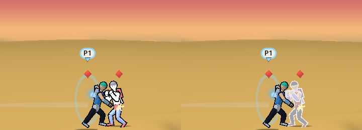
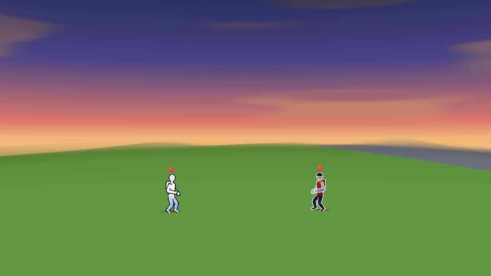
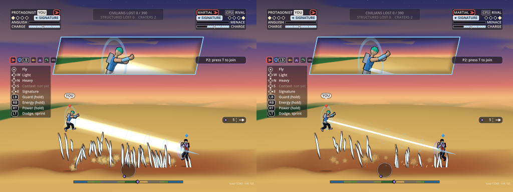
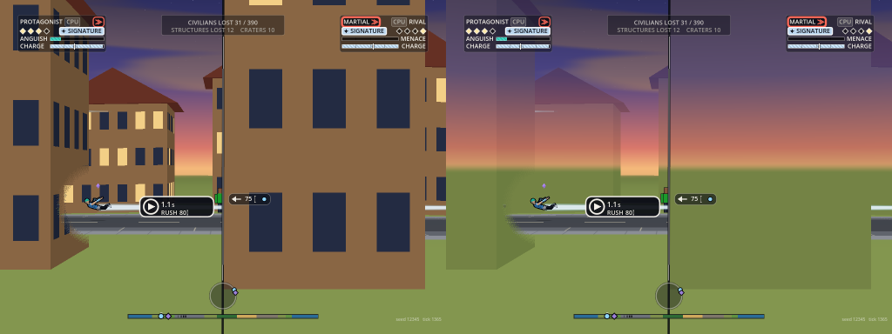
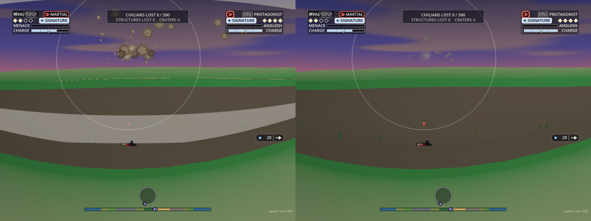
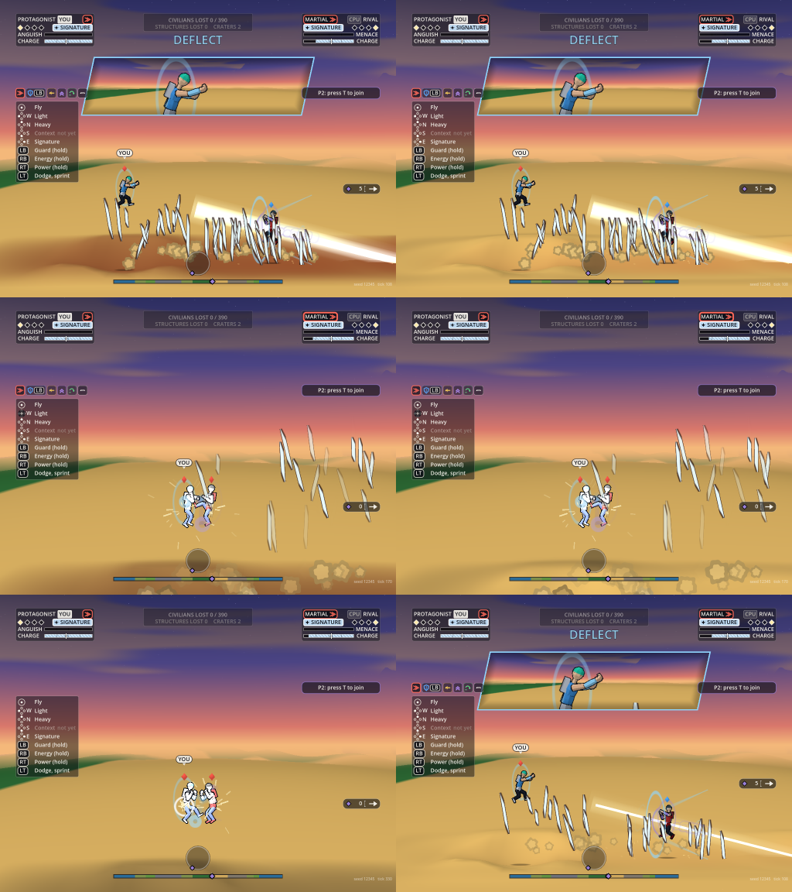
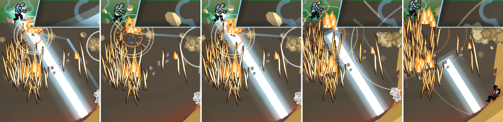

# Rendering's flashes and the shared flash register

Owner: Rendering and Technical Art. 2026-10-06. Legal's condition for the public web build (`docs/legal/photosensitivity-note.md`): at most three full flashes in any second across the whole screen, one under reduced flashing, never red. VFX built the register (`render/vfx/flash_registry.gd`, `hub.flashes`; `docs/vfx/flash-registry.md`). This page is Rendering's half: every full flash drawn from `render/core` and `render/shaders` asks it first.

## How a flash of Rendering's asks

- **One call:** `SimHost.ask_flash(source, colour, area_px, step)`. It returns whether the flash may be drawn. The register weighs a flash by the area it covers against a quarter of the standard's 341 by 256 window (21,824 px at 1024 by 768), and a step under a tenth of full luminance costs nothing. In any second the granted weights sum to at most 2.5 (1.0 under reduced flashing), the low class's to 1.5 (none), with at most 3 flashes of half weight or more and 6 of any weight. A red colour is never granted. The rules are VFX's (`docs/vfx/flash-registry.md`).
- **Each source gives its own area and step.** Sizes are world units on the fighters' plane (`RenderLook.FLASH_*`), turned into pixels at the camera's scale by `SimHost.flash_px`. A beam counts its body's width along as much of its length as one window holds (426 px), so a beam seen from far is a thin strip and weighs little. The steps are estimates.
- **The camera's scale** is `host.vfx.px_per_unit`, set by main every frame: 768 over the visible world height on the fighters' plane. In a split it is the closer pane's, where a flash covers the most.
- **Once for the screen.** The host asks, not a view, so a flash seen in both panes of a split is one flash and one slot.
- **After VFX.** Each tick the host asks after VFX has consumed the tick's events, so the register's clock is that tick's and VFX's big events (an explosion, a transformation) have asked first. Rendering's order is: head flashes, a perfect block's guard flash, a cue's flare, a new beam, a beam clash, and last a new hit's white body. UI's divider asks from the frame, so after all of the tick's.
- **Low priority is the register's own list.** `body_hit`, `head_flash`, `cue_flare` and UI's `divider_slam` are sources a fight makes many of: they share at most 1.5 of the 2.5 and get nothing under reduced flashing. `guard_flash` is not low (the EP's ruling, 2026-10-06: a perfect block is a moment the player earned), nor is a beam or a clash. The host keeps no list of its own, so every ask and every refusal is in the register's log.
- **With VFX off** (`--novfx`) the hub does not run its register, so the host ticks it. Rendering's flashes keep to the limit either way.
- **Presentation only.** Nothing here reads a random number or writes the sim.

## Every flash source in Rendering's paths

| Source | Where | What it is | Under the register | When refused |
| :-- | :-- | :-- | :-- | :-- |
| **A hit's tint on the body** | `fighter_view.gd`, `fighter_body.gdshader` (`hit_mix`), 0.12 s | The body takes a strong light tint of its own colours, 60% of the way to white, with the outline lit. It went pure white before Legal's RL-122 | **Yes**, `body_hit` (low). The host asks once for each new hit (`SimHost._ask_hits`), and only while Legal's ceilings allow: one body at most 3 times in a second, the two together at most 4 | **The outline alone lights** pale for the same 0.12 s (`RenderLook.HIT_EDGE`). It is a line a pixel or two wide, not a flash. The hit still lands; its sparks, the flinch and the damage marks are as before |
| The same on the placeholder parts | `fighter_view.gd` (`solid`) | The box figure's parts take the same tint (the old look, `--noanim`) | **Yes**, the same grant | They keep their colour |
| **A perfect block's guard flash** | `fighter_view.gd`, `guard.gdshader`, 0.3 s | The guard arc's line thickens, a second line leaves it, and its fill deepens | **Yes**, `guard_flash` (not low: it may take the slot kept for big events), once for each block | The two lines still flash; the fill does not deepen (`flash_fill` 0). Lines are not a flash |
| **Head flashes** | `flash_view.gd` | Small shapes at the head that swell two or three times in under a second | **Yes**, `head_flash` (low). Each swell asks as the flash starts, so a three-swell flash plays as many swells as were granted | With none granted the flash still shows once, calm: it fades in, holds and fades, with no swell, sweep or jitter (the reduced-motion form). The player still gets what it says |
| **A cue's flare** | `fighter_view.gd` (`flare`) | A soft glow at the chest, up to a body and a half across, on four of Combat's cue poses | **Yes**, `cue_flare` (low), once for each fighter the cue plays on | No flare. The pose, the hand spark and the ring still play |
| **A signature beam** | `beam_view.gd` | Three additive cylinders, the inner one white, with soft edges. Its strength rises over 0.1 s, holds and falls to nothing at its end: one rise and one fall. Bright, its tail leaves the firer at no more than 1,000 pixels of beam a tick ("The beam's tail") | **Yes**, `beam` (not low: a big event), once for each beam. Under reduced flashing it does not ask | **Calm:** a thin line in the beam's own colour where the white core was (0.3 of its width), and the glow at 18% of its strength, which adds under a tenth of full luminance. Always calm under reduced flashing |
| **A beam clash's flare** | `beam_view.gd` | A white glow where two beams meet, with the two clash beams. All three rise over 0.15 s and fall over the clash's last 0.25 s | **Yes**, `beam_clash` (not low), once for each clash. Under reduced flashing it does not ask | No flare; the two beams are drawn calm, as a refused beam is |
| **The split divider's slam flash** | UI draws it (`ui_hud.gd`, `_slam_scale`); Camera's rig gives the amount (`slam` in the split record); the host answers (`main._hud_flash`, set as `UiHud.flash_fn`) | The divider's light line widens to two and a half times and goes fully opaque for 0.08 s as a slam shuts the split | **Yes**, `divider_slam`, once as a slam begins. Not in the register's low list yet (see below) | UI draws the divider as it is, with no flash (the answer is all or none) |
| A cue's hand spark and ring | `fighter_view.gd` | A small spark at the hand; a hollow ring | No: small or hollow, not a flash | |
| The placeholder aura, speed streaks and charge orb | `fighter_view.gd` | The old look in place of head flashes (F7 off) | No: a debug view, not in normal play | |
| Sparks, debris, dust, splashes, ripples, shock rings, after-images | `particle_view.gd`, `impact_fx.gd` | Points a few pixels across, hollow rings, thin outlines | No: not a flash | |
| **A fresh groove's glow and char** | `impact_fx.gd` (the heat), `terrain.gdshader` | A beam's burn: a glow along the groove that cools over seconds, and the dark char it leaves | No ask: it is the ground, not an effect. The char comes in as the groove cools (two to three seconds), where it used to turn a broad strip dark in one tick | Under reduced flashing the glow is drawn at 30% and the char at 35%, so a camera moving over a groove changes little |
| Windows going out, a building's damage stage | `building.gdshader` | A step in a building's look, once | No: one change, never repeated | |
| The sky's reaction to tier 3 and 4 | `sky.gdshader` | Off by default | No: off | |
| The old HUD's banner and floating words | `hud.gd` | Text, in the F2 debug view | No: a debug view | |

Not Rendering's, though they are drawn near these: the glare on the rival's glasses (VFX's `glare.gd`), every ring and burst in `render/vfx`, and Camera's three sources, which ask the register themselves with their area and step: `cut_dip` (a camera cut's brief dip), `cut_in_panel` (the inset panel) and `transform_cut` (a transformation's two cuts, the whole frame). `SimHost.ask_flash(source, colour, area_px, step)` passes the area and step through for any caller. The divider's slam flash is UI's to draw and Camera's to time; only the ask goes through the host.

## What it does in play

`render/tools/flash_reg_check.gd` (headless, through the real scene, the three matches in Camera's split screen as the game runs it), on HEAD 75446511 with VFX's area-weighted register:

- **Three AI matches of 3,600 ticks** (seeds 12345, 4 and 7): in every second the register's four limits hold, Rendering's, VFX's and the divider's together. The worst second's weights sum to 2.40, 1.95 and 2.35.

| Seed | Body white: granted, refused | Head flash pulses | Guard flash | Beams |
| :-- | :-- | :-- | :-- | :-- |
| 12345 | 119, 30 | 13, 5 | 1, 1 | 3, 1 |
| 4 | 142, 20 | 13, 5 | 2, 4 | 1, 0 |
| 7 | 111, 26 | 17, 5 | 2, 3 | 2, 0 |

- **A body's tint is held lower than the register alone would hold it** (Legal's RL-122, as comfort and margin: two bodies and their effects share one window in a close brawl): one body at most 3 times in a second, the two together at most 4, and a light tint in place of pure white.
- **A close brawl:** both fighters hit every 6 ticks for 4 seconds, 80 hits. A body is tinted at most twice in a second and the two together at most 3 times; 9 tints in all, and every hit lights the outline.
- **The same with UI's Reduce flashing on:** neither body is tinted, and the reduced limits hold.
- **The camera's scale** reaches the register every frame.
- **Weights at the close framing** (1.3 px a world unit): a body's white 0.17, a head flash 0.07, a guard flash 0.19, a tier 4 beam 1; the same tier 1 beam seen from far weighs 0.25.
- **The weighted rule through the host's ask:** the low class takes 1.5 and no more; a perfect block's guard flash takes what the low class may not; a full flash over the budget is refused; a step under a tenth costs nothing; six small flashes and no seventh; three of half weight and no fourth; a red flare refused.
- **Head flashes:** a three-swell flash asks for three; with none granted it shows once, calm; with two it swells twice.
- **UI's Reduce flashing option:** the register goes into its reduced mode and comes back with the option off.
- **The divider:** the HUD's `flash_fn` gets all of the flash with room in the second and none with the second full, and both asks are in the register's log.
- **Controls' two charge settings:** with Controls' uncommitted hub copied in, each goes to the hub for the player who set it and off again. On HEAD the hub has no such functions and the check says so.
- **A beam and a clash:** each strength curve has one rise and one fall. A new beam asks with its own weight and is granted; under UI's Reduce flashing it does not ask and is calm.
- **The pan haze:** off unless switched on; then none at a fifth of a screen width a second, full within 6 ticks of two a second, unmoved by a cut, cleared in one fall.
- **The whip haze:** on in every match, with the whole town's off; none in a rush of a screen width a second, whole within 6 ticks of four, unmoved by a cut, cleared in one fall; both building materials hold its strength.

In the table a hit past Legal's ceilings does not ask, so it is in neither column. A granted hit before (left, pure white) and now (right, a light tint with the outline lit), on the web build: 

A hit granted (left) and a hit refused (right), on the web build: 

## UI's Reduce flashing setting

`main.frame` gives UI's `reduce_flashing` option to `host.vfx.reduced_flashing` every frame, beside reduced motion. Either one puts the register in its reduced mode: a budget of 1.0 by weight in a second on the whole screen (one full flash), and nothing for a low source. For Rendering's sources that means:

- **A hit's tint on the body, head flashes, a cue's flare (low):** never granted. The outline lights on every hit, a head flash shows once in its calm form, a cue has no flare.
- **A perfect block's guard flash (not low):** it may take the second's one slot, with VFX's big events. Refused, the arc's lines flash without the fill.
- **A beam and a beam clash:** always calm, and they do not ask, so the one slot is left to others. A beam is a thin line with a faint glow; a clash has no flare.
- **The divider's slam flash:** UI draws none and does not ask.
- **A groove's glow and char:** the glow at 30% of its strength with no brightening past its colour, the char at 35%.
- **The pan haze** does not follow the setting: it is off unless switched on. The whip haze is on in both modes.
- **Nothing of Rendering's reads the option itself.** Each source asks the register, so there is one rule and one log.

The setting is behind UI's `reduce_flashing` flag, which is off, so today the option is always false.

## The divider's slam flash is not seen in play today

The ask is wired and checked, but in play it is never made, because the flash is never drawn.

- **Camera's rig starts the flash on the tick the slam closes the split** (`split_rig.gd`, `_slam_step`): the same lines set `sep` to 0 and the flash to 0.08 s. The line's opacity follows `sep`, so it is 0 too.
- **UI draws the divider only while the panes are open** (`UiSplit.divider_active`: `sep` and `fade` above 0.01), and `_slam_scale` is only reached then.
- **Measured:** three AI matches of 3,600 ticks in the split screen had one slam each. At 60 frames a second, on all 14 frames with a slam amount above zero `sep` and `fade` were 0, the divider was hidden and the register was asked 0 times. At 144 frames a second (in-between frames), 40 such frames: the divider was drawn on one, at under 1% opacity with a quarter of the slam amount, and again nothing was asked.

So this source adds no flash to the screen now. It is Camera's and UI's to decide whether the flash should show (start it before the panes close, or draw the line while it runs); if it does, the ask is already in place.

**Priority: low is right.** It is a flourish on a camera move, not something a player has to read, and it should not take the slot kept for an explosion, a transformation or a perfect block. VFX has added the name to `VfxFlashRegistry.LOW` (1bf5d903).

## The frame analyser's clips: Rendering's half (2026-10-06)

Tools' analyser reads recorded frames against the standard, and the gate is 2.5 flashes in the worst second (`docs/tools/flash-check.md`; `docs/legal/photosensitivity-note.md`). This is what the frames show, what changed in Rendering's paths, and what the same clips read before and after.

**Method.** Twelve clips were captured from a web export of 2dc8a663 with Tools' runner (1024 by 768) as the "before", and again from the same commit with this batch's files. Every clip was then read with one copy of Tools' committed analyser (501e19c5, the one whose count no longer depends on where a clip starts). An earlier table in this file's history used the analyser before that fix and read higher; it does not stand. The captures are before VFX's area-weighted register and Camera's scroll governor, so they show this batch's drawing changes alone, not today's tree.

| Clip | Before: normal, reduced | As shipped (haze off) | With `--panhaze` |
| :-- | :-- | :-- | :-- |
| collapse | **4.5, 4.5** | **4.5, 4.5** | 2.5, **3** |
| ai, seed 12345 | **3, 3** | **3, 3** | **3, 3** |
| ai, seed 4 | 2.5, 2 | 2.5, 2 | 2.5, 2 |
| ai, seed 7 | 2.5, 2.5 | 2.5, 2 | 2.5, 2 |
| clash | 2, 2 | 1.5, **3** | the same |
| mash | 2.5, 2 | 2.5, 2 | the same |

Bold is over the gate. The analyser also reads each clip with the area threshold 15% up and down: clash reduced reads 2 to 3, collapse reduced with the haze 2.5 to 3, seed 4 normal 2.5 to 3.5. Those sit on the threshold's edge.

### What changed

- **A beam comes and goes once.** Its strength rises over 0.1 s, where it was at full strength on its first tick, and its three layers have soft edges, where the glow was flat-topped with a hard edge.
- **A refused beam, and every beam under reduced flashing, is calm:** a thin line in the beam's colour with a faint glow. It still shows where the beam is. Before, a "reduced" beam could take the second's one slot and be drawn at full size.
- **A clash's flare and beams rise and fall** over 0.15 and 0.25 s, where they came on and went off in one tick.
- **The pan haze, off unless switched on, and not needed** (`--panhaze`, on the web `?panhaze=1`; `RenderLook.PAN_HAZE_DEFAULT` is the one line that flips it). The EP's ruling, 2026-10-06: collapse passes Legal's rule at 2.5 with Camera's scroll governor, so the haze stays off and its code stays behind the switch. While a pane's camera travels along the ground faster than 0.35 screen widths a second, the buildings lose their windows and marks and melt toward what is behind them: the sky's colour above the horizon line, the ground's below it. It is complete at 0.9 widths a second and 70% strong, comes in over 0.1 s and clears over 0.6 s.

### What each costs the look

- **The beam** reads softer at its edges and a little slimmer; the rise is too quick to see. Granted (left) and calm (right): 
- **The pan haze** is the large one, which is why it ships off: it is Orb's to decide. In a rush through a town the buildings turn to pale ghosts until the camera slows, and a building a fighter is flying at is a ghost until then. They keep their shapes and come back in about half a second. Before (left) and with the haze (right), the same tick of the collapse clip: 
- Nothing changes in a frame with no beam, no clash and no haze: frames of the mash clip are the same to the pixel before and after.

### Clip by clip

1. **collapse, ticks 1351 to 1397 (4.5; with the haze 2.5 normal, 3 reduced).** Both fighters rush through a village and the camera goes with them: the picture is a different set of buildings every three ticks, and 100,000 to 200,000 pixels change in each direction on each frame (lit and dark windows, walls against the sunset, walls against the grass). As shipped that is unchanged. With the haze that second is calm, and the clip's worst second moves to ticks 67 to 112, where the changes are at 103 to 107% of the area threshold; some of them are the haze itself coming and going as the camera's speed crosses its thresholds. The camera's speed is the cause, and Camera's scroll governor limits it.
2. **ai, seed 12345 (3, unchanged).** The worst second is tick 559: a transformation, where the whole screen dims at tick 582 and comes back at 612, with white spikes on the scorch. Not Rendering's. The beam's impact at tick 3290 read worst under the earlier analyser and no longer does.
3. **ai, seed 4 and seed 7 (2.5, unchanged).** At the gate, not over it.
4. **clash (2, 2 to 1.5, 3).** The changes in its busy seconds are the camera's reframe as a beam lands, with the ground's scorch band darkening in the same tick; Camera's inset panel opening and closing; and the camera moving over the glowing groove and the dark scorch on pale sand as the split opens. The reduced clip went from 2 to 3 with this batch: two more changes at 100 and 101% of the threshold in the second from tick 1137, where the calm beam's thin line replaces the broad dim one. It reads 2 with the threshold 15% higher. It is over the gate as read, and it is the groove's glow under a moving camera that it counts.
5. **mash (2.5, unchanged).** A launch's trail, VFX's rings and speed lines, UI's prompt chips and the swinging divider; nothing of Rendering's was changed for it.

### The broad grey band was VFX's

In seed 4 and seed 12345 a broad pale band lay across a fresh crater and came and went as the camera moved. With VFX's drawing off it was not there; with the terrain's fog off, or the water off, it still was. Baseline (left) and VFX off (right), seed 4, tick 1830: 

It was the crater's shock ring, drawn as a band a third of its radius thick; VFX has made it a thin line (1bf5d903).

### Limits of this half

- **The clips are from before VFX's and Camera's changes.** Tools reads the combined tree; these numbers are this batch alone.
- **The counts sit on the threshold.** Many counted changes are 100 to 115% of the area threshold, so half a flash either way is noise; a fall from 4.5 to 2.5 is not.
- **The groove's glow and char** were the clash's remaining reading; see "The groove" below.
- **The haze sees travel along the ground only, and buildings only.** A camera climbing or zooming past a tower, and a rush through a forest, are not covered. Its own coming and going is a change of its own.
- **The areas and steps given to the register are estimates** of what changes by a tenth of full luminance, not measurements.

## The groove (2026-10-06, evening)

A beam's burn used to do two things the analyser counts: turn a broad strip of ground dark in one tick, and leave a bright glow beside a dark char for a moving camera to sweep over.

- **The char comes in as the groove cools.** While a groove is hot the ground under its glow keeps its own colour; the char eases in over two to three seconds as the heat falls (`RenderLook.CHAR_FRESH`, on the heat `ImpactFx` already keeps, so nothing new is uploaded). A weak beam's groove starts as a faint red tint, where it was a dark red band at once.
- **Under reduced flashing the groove is calm:** the glow at 30% and the char at 35% (`HEAT_CALM`, `CHAR_CALM`). Scorch marks are fainter for a player with the setting on.

Before and after, on exports of 1172a4e8 (today's tree, with VFX's register and Camera's governor), read with that commit's analyser. The second figure is the reading with the area threshold 15% lower.

| Clip | Before | After |
| :-- | :-- | :-- |
| clash, normal | 1.5 (2) | 2 (2.5) |
| clash, reduced | **3** (3) | 2 (2) |
| signature, normal | 2.5 (3) | 2.5 (2.5) |
| signature, reduced | 2.5 (2.5) | 1 (1) |

Every clip is at or under the gate of 2.5 after, and none reads over 3 with the lower threshold. Clash in normal mode moved from 1.5 to 2: the char's darkening no longer lands on the tick of the camera's reframe, and one change at 118% of the threshold now stands apart where it merged before. The two-second-memory reading was not run.

What it costs the look: the mark of a beam appears late. The ground glows, then darkens over a few seconds, where the black scar used to be there the moment the beam passed. Top row: tick 108, before and after. Middle: tick 170, before and after. Bottom: tick 330 after, when the char is in; and the reduced form at tick 108. 

## The beam's tail (2026-10-11)

Tools' reading of ai seed 1 in normal mode (4 in the worst second, ticks 2147 to 2181): a signature beam landing on a cliff face, its thick white core ending in one step at tick 2153.

- **Why it went in one tick.** The beam was not ending. A beam's tail draws back from the firer from 0.4 s and reaches the beam's far end as its life ends, so its pace is the beam's length over about half a second. This beam reaches a defender across the planet and is 32,058 units long: its tail left at 605 units a tick, off the firer's screen in one tick, at 0.88 of full strength.
- **Now** a bright beam's tail uncovers at most `RenderLook.BEAM_TAIL_PX` (1,000) pixels of beam a tick at the register's scale (`BeamView.tail_at`), the beam taken as wide as the register takes it. Here that is 18 pixels a tick along the beam. A beam whose tail was slower than that is as it was. What the tail has not reached when the beam's life ends has faded to nothing by then.
- **The calm beam is untouched** (refused, or reduced flashing). Capping it too was measured and was worse: a thin line held on screen under a moving camera took ai seed 1 reduced from 2.5 to 3.5. As shipped the reduced clip is the same to the pixel.

Before (ticks 2152 and 2153) and after (2153, 2158 and 2164): 

Ticks 2040 to 2240 of ai seed 1 at 1024 by 768, read by Tools' analyser as it was at ce61e3f5. Before is an export of ce61e3f5, whose `render/`, `sim/` and `data/` are 823239ee's; after is 823239ee with this change.

| | Worst second | Area threshold 15% lower | Two-second memory | The change at tick 2153 |
|---|---|---|---|---|
| Normal, before | **4** | **4** | 1.5 | 121% of the threshold (143% of the lower one) |
| Normal, after | **3** | **4** | 1.5 | not counted (89%); 105% of the lower one |
| Normal, no beam drawn at all (a scratch build) | 2 | 2 | 1.5 | none |
| Reduced, before and after | 2.5 | 2 | 1 | none |

- **The clip still fails the combined rule** on the stricter reading, and still reads 3 against the gate of 2.5.
- **What is left is not the beam's end.** With no beam drawn the clip reads 2, so a bright beam still costs one flash on the main reading and two on the stricter one, and neither is a change of the beam's own. The analyser counts, on each frame, only the direction that turned more pixels, and under Camera's re-frame the scenery here turns 2 to 3% of the picture each way on every tick. At tick 2153 the beam's flank, moved 7 pixels by the pan, tips a balanced frame to darker (26,987 pixels against 20,911; without the beam 18,801 against 22,491). At ticks 2172 to 2174 its footprint tips three near-balanced frames to brighter, which splits one long darkening into two. Both go with Camera's and VFX's parts of this clip, not with a different beam.
- **signature and clash in normal mode, before and after:** signature read 2.5, 2.5 and 2 before (the worst second, the lower threshold, the two-second memory) and 1.5, 1.5 and 1 after; clash read 2, 2.5 and 2 before and 2, 3 and 2.5 after. Both pass before and after. Clash's two stricter readings are half a flash up, and its lower-threshold reading now sits on the limit of 3 (full clips, 1,500 ticks each).
- `tools/after_check.gd` asserts the cap at five zooms and that the calm tail is where it was.

## The window fade: tried, and worse (2026-10-06)

Camera read the collapse fly-by as a window grid flipping whole house fronts, and the EP asked for the windows, soot and cracks to fade toward the plain wall as the scenery crosses a pane fast (from 25 to 70 pixels a tick). It was built and measured on an export of d745a5f1, and not shipped.

| Collapse, by Tools' `check-clip` | Normal | Reduced |
| :-- | :-- | :-- |
| Before | 2.5 | 2.5 |
| With the fade | **3.5** | **3.5** |

With the windows held fully gone for the whole fly-by, the second still reads 3.5 on the same seven changes. So the analyser counts the house bodies against the sunset and the grass. The windows break a front into mixed lighter and darker pixels; a plain wall flips the whole front one way, which is worse. The margin on this clip cannot come from fading detail: the levers are the camera's scroll in towns and the pursuit's speed through one.

## The collapse in reduced mode: the crater (2026-10-12)

On the shorter city with three streets the collapse clip passed in normal mode and failed in reduced mode. The worst second is the clip's first blast: two blasts three ticks apart at a tower's foot, the tower gone to a shell and then down.

**Which layer it hangs on.** Three scratch exports of aaa93683, each with one layer of that second held still, by Tools' `check-clip` (primary reading, the area threshold 15% lower, the two-second memory; the gate is 2.5 and 3):

| What is held still | Normal | Reduced |
| :-- | :-- | :-- |
| Nothing (the game as it is) | 2.5 / 2.5 / 2.5, pass | 3.5 / 3.5 / 2.5, fail |
| **The ground: no crater earth, ejecta or char** | 2.5 / 2.5 / 2.5, pass | **2.5 / 2.5 / 2.5, pass** |
| The tower's face: no stage look, no windows out | 3.5 / 3.5 / 3, fail | 3 / 3.5 / 3, fail |
| The tower's top: never cut down, never gone | 3.5 / 3.5 / 2.5, fail | 2.5 / 3.5 / 2.5, fail |

- **Only the ground gives a pass in both modes.** Holding the tower's face or its top makes normal mode worse: a whole face that stays lit against the dusk flips the other way.
- **Why reduced mode was the worse one.** In normal mode a fresh crater is under its own bright glow and darkens as it cools, over seconds. Reduced mode draws that glow at three tenths (`HEAT_CALM`), and a blast's crater has no glow at all (only a beam's has), so the street went from pale pavement to dark earth in one tick, twice in a tenth of a second. The second darkening was the change that took the count over.

**The ease, reduced mode only** (`RenderLook.CRATER_CALM_S`, `ground.gdshaderinc` `crater_new`). Under reduced flashing or reduced motion a new crater keeps the ground's own colour at first. Its earth, its ejecta and its char spread from its centre to the edge of its apron over 1.5 s of match time. The bowl's shape is there at once: the street bends down, and its colour follows. Ground that an older crater already coloured is not given back. Normal mode is not changed: the shader takes the old path, and its counted changes are the same, tick for tick.

| Collapse, on an export of 6d3a945d | Normal | Reduced |
| :-- | :-- | :-- |
| Before | 2.5 / 2.5 / 2.5, pass | 3 / 3.5 / 2.5, fail |
| With the ease | 2.5 / 2.5 / 2.5, pass | **2.5 / 2.5 / 2.5, pass** |

- **It passes at the gate, with nothing to spare.** Half a flash either way is this clip's noise.
- **The other reduced clips with craters read the same with it as without it:** signature 2.5 / 2.5 / 2.5 and clash 2 / 2 / 2, both a pass. The AI matches and the mash were not run.
- **What it removes** is the darkening counted at tick 99. A smaller one is counted at tick 130, when the spread has covered enough ground; it falls outside the worst second.
- **It does not make every tick small.** At tick 91, 18% of the screen still darkens in one tick where it was 22%: most of that is the tower's face, which the table above says not to touch.
- **What it costs the look in reduced mode:** for a second and a half a fresh crater is a dent in painted street, lane marks and all, before it is earth.
- `tools/flash_reg_check.gd` asserts the ease is on under UI's Reduce flashing and off without it.

## The collapse clip's first blast, and what fails the clip (2026-10-13)

The brief: the clip's first blast (seed 12345, ticks 84 to 144) read 2.5 / 3.5 and was taken for the last thing between the clip and a pass. Measured on main (bc4b3972), which has the stage spread of that morning:

- **The first blast reads 1.5 / 2.5 in normal mode and 1 / 1.5 in reduced** (primary, then the area threshold 15% lower). The 2.5 / 3.5 is that second without the spread: a scratch export with the spread switched off reads 2.5 / 3.5 again.
- **What fails the clip on Tools' path is ticks 731 to 752,** after the fifth blast. The camera travels after a launched body, and 20 to 30% of the screen turns each way on every tick for twenty ticks: seven counted swings in a second, 3.5. No layer of mine is changing then. With Camera's launch hold switched on (`--hold`) the first 800 ticks read 1.5 / 2.5 / 1.5, a pass.

**The first blast, a layer at a time.** A scratch export of bc4b3972 with a switch a layer, read from the page, the first 200 ticks in normal mode. An event is a run of ticks that turn mostly one way; its size is the pixels it turned in the fullest window as a share of the threshold.

| Scratch switch | Reading | Counted events |
| :-- | :-- | :-- |
| None (main) | 1.5 / 2.5 | 84+ 271%, 93- 285%, 103+ 121%, 110+ 298% |
| No stage spread | 2.5 / 3.5 | 84+ 251%, 91- 253%, 94+ 265%, 98- 132%, 103+ 125%, 110+ 264% |
| The ground's calm form in normal mode | 0.5 / 1.5 | 84+ 350%, 110+ 208%, 149+ 129% |
| No ground at all | 0.5 / 1.5 | 84+ 341%, 104+ 115%, 111+ 181% |
| The glow cooling four times slower, or held 1.2 s | 1.5 / 2.5 | as main |
| No shock rings | 1.5 / 2.5 | 84+ 282%, 94- 254%, 115+ 263% |
| A building never shrinks | 1.5 / 2.5 | as main |
| No camera shake (on the build with changes 1, 2 and 4 below) | 1.5 / 2.5 | 84+ 269%, 94- 288%, 103+ 129%, 110+ 264% |

- **84+ is the camera,** before the blast: the two panes merging, and then the crater's tick joins the same run.
- **What the 285% darkening was** (the frames and the pooled mask). The second blast lands three ticks after the first, and the spread began again on it: everything the first wave had not reached jumped to the stage between, so the near tower went black in one tick (63,000 pixels). Its top half went in one frame. Whole rows of lit windows went out with VFX's blow-outs, 12,000 pixels a lit cell on a near tower. And the camera, zooming in after the merge, carries the bright crater off the bottom of the frame.
- **The glow's cooling is not it:** four times slower, or held, changes nothing.
- **The calm form's low reading is the pooling, not a quieter picture.** Only a frame's dominant direction is pooled. With a faint glow the brightening outweighs the darkening on those ticks, and the darkening is dropped whole. Not a way to pass in normal mode.
- **The shake is not it either:** with none, the darkening is one longer run.

**What was changed, all in my layers, in every match** (`building-stages.md` has the rules):

1. A second stage change while a spread is going spreads inside it as a second wave. The first wave keeps what it has not reached at the stage before it.
2. A building brought lower by a hit comes down at 900 units a second.
3. The floors a blow-out puts out go as a wave, like a stage.
4. A window cell that is large on the screen is taken in pieces of 1,200 pixels at most.
5. A blast's wave starts at the blast's own height (its crater's event), and each building's wave has the whole area a tick. Shared among every building a blast touched, most of them off the screen, the near tower stayed lit for 2.5 seconds and then changed at once: a counted event of its own at tick 241.

| The first blast, first 260 ticks | Normal | Reduced |
| :-- | :-- | :-- |
| Main (bc4b3972) | 1.5 / 2.5: 84+ 271%, 93- 285%, 103+ 121%, 110+ 298% | 1 / 1.5: 77- 179%, 84+ 344%, 110+ 201%, 147+ 141% |
| With the five changes | 1.5 / 2.5: 84+ 271%, 93- 119%, 97- 139%, 104+ 109%, 110+ 275% | 1 / 1.5: 77- 179%, 84+ 302%, 102+ 165%, 109+ 212%, 145+ 156% |

- **The count is the same; the largest darkening is half the size** (285% of the threshold to 139%), and nothing of mine changes more than the wave's area in one tick at that blast.
- **The whole clip:** Tools' path, both modes, before (bc4b3972) and after: the same worst second, 3.5 / 3.5 / 3.5 in normal mode (ticks 731 to 754, the camera's travel: a fail that is main's own) and 2.5 / 2.5 / 2.5 in reduced (a pass). From tick 303 on the two clips count the same events.
- **With Camera's launch hold on:** the first 800 ticks read 1.5 / 2.5 / 1.5 in normal mode and 1 / 1.5 / 1 in reduced, before and after: a pass both ways. I ran the first 800 ticks only; Tools has the full clips with Camera's switches.
- **Why the count does not fall further.** From tick 92 to tick 112 about 20,000 pixels turn each way on every tick with nothing of mine changing: the camera's pan and zoom over lit windows and over the glowing crater. A run of two or three such ticks reaches the threshold whichever way it tips. More margin at this blast is in the camera's travel, or in the contrast of lit windows and glow against the dusk, which is a look decision. It is not in more spreading.
- **Scratch tools:** `tog16.py` (the switches), `pool.js` (the pooling tick by tick, and a run's mask), `turnmap.js`, `boxlum.js`.

## The foreground rule at a landing: ai 38, ai 4, collapse (2026-10-13 and 14)

**What it was.** VFX traced the AI clips' last failing seconds to the ground: they read the same with the VFX hub off. A scratch probe ran ai seed 38 headless and printed the ground's inputs every tick. At its landing (tick 3482) they change once: a slide's record, and a heap three columns long and 64 units tall at its end, on the fighter plane. For the next twelve ticks nothing in the ground's data changes, while a dark triangle comes and goes in front of the bowl. It goes with render/core's particles all off too, and only a frozen ground removes it.

What draws it is the **foreground rule** (`fore_fall` in `ground.gdshaderinc`). In front of the fighter plane no ground rises above the sight line from the camera to the plane's own ground. A sharp rise in the plane's profile made the rule's cap throw a ridge toward the camera, and its lit and its shaded face swept across the foreground as the camera moved. ai seed 4's failing second (ticks 2504 to 2522, a fighter down at 2500) and the collapse clip's in reduced mode (1137, round the grounded fighter) are the same thing.

**The fix, in every match.** The rule reads the fighter plane's **lowest ground within two columns either side** (`FORE_SPAN`) of where the sight line meets it, and the slope it shades by is that profile's **difference across one column**. A rise narrower than that throws no ridge, and the cap can only come out lower, so nothing in front hides more of the fight.

- **A first version took the slope of whichever column was lowest.** Where two columns stood near the same height that choice flipped from tick to tick as the camera moved. On the chain's fights it made new one-to-three-tick flickers: a stretch of the collapse clip in reduced mode (ticks 1101 to 1260) read 5.5 / 7.5 where main reads 3.5 / 4.5. With the slope from the profile's own difference, which changes smoothly, the same stretch read 1.5 / 2.5. Both of those builds also had the crater opening and the reduced-mode earth below.
- **Three columns either side** took ai seed 39 normal from 2.5 to 3 / 4.5. At its divider slam the camera's travel turns 40,000 to 50,000 pixels each way every tick, and the cap's change of a thousand or two tipped one tick the other way. Two columns keep every win measured and leave that second as main has it (on 3dda977f, a stretch of ticks 2651 to 2850: 2.5 / 2.5); one column reads 2.5 / 3 there.
- **A narrower fix was tried and is not enough:** the rule's heights as they were, with only the slope it shades by held under 0.35. Seed 38's landing still read 3 and 4.

**Measured** with Tools' `check-clip`, primary / area threshold 15% lower / two-second memory, main and main with the fix both on 4cc7319a (the same scenes; Animation's three styles of that commit moved the clips' pixels from Tools' table on 3198301f):

| Clip | Main | With the fix |
| :-- | :-- | :-- |
| ai-4-normal | **FAIL** 4 / 4 / 1.5 | 2 / 2 / 1.5 |
| ai-4-reduced | **FAIL** 4 / 4 / 2 | 2 / 2 / 2 |
| collapse-reduced | **FAIL** 3 / 4 / 3 | 2 / 2 / 1 |
| collapse-normal | **OVER GATE** 3 / 3 / 3 | 2 / 2 / 0.5 |
| ai-38-normal | **OVER GATE** 3 / 3 / 3 | **OVER GATE** 3 / 3 / 3 |
| ai-38-reduced | 2.5 / 2.5 / 1.5 | 2.5 / 2.5 / 2.5 |
| ai-39-normal | **FAIL** 3 / 3.5 / 3 | **FAIL** 3 / 3.5 / 3 |

- **ai seed 39 normal** fails on main itself since 4cc7319a (Tools' table on 3198301f read it 2.5). Its worst second is the divider's slam (ticks 2736 to 2750, the camera's travel), the same events with the fix and without. It is Camera's, as the same clip's reduced mode is.
- **ai seed 38 normal** is over the gate on main since 4cc7319a (on 7fef83e3 it read 1.5 / 2.5 / 1.5), at ticks 2055 to 2104: the same events, tick for tick, with the fix and without. Not traced here. With the fix its reduced mode's two-second-memory reading goes from 1.5 to 2.5 (at 2099); its primary and area readings and its events at 2055 to 2136 are unchanged.
- **The other 21 clips** were swept on 3dda977f with the fix at three columns, against Tools' table on 3198301f; nothing that runs in a clip changed between those two commits. Not re-run at two columns. Lower: ai-12345 normal 2 / 2.5 / 2 to 2 / 2 / 2 and reduced 2.5 / 2.5 / 2 to 2 / 2 / 2 (out of the second capture); clash reduced 2 / 2 / 2 to 1 / 2 / 1; ai-5 reduced 1.5 / 1.5 / 2 to 1 / 2 / 1. Higher, all passing: ai-5 normal 1.5 / 1.5 / 1.5 to 2 / 2 / 2.5; ai-3 reduced 1.5 / 1.5 / 1.5 to 2 / 2 / 1.5; ai-7 normal 2.5 / 2.5 / 2 to 2.5 / 3 / 2.5 and reduced 2 / 2 / 2 to 2 / 2.5 / 2; signature reduced 2 / 2 / 2.5 to 2.5 / 2.5 / 2.5. The same: both mash clips and both mashcity clips, clash normal, signature normal, both transform clips, both ai-1 clips, ai-3 normal, and ai-39 reduced (still **FAIL** 3 / 3.5 / 2.5 at the divider's slam, Camera's).
- On 39f93535, before the chain, the fix took ai seed 38 from 4 / 5 to 2.5 in both modes. That was the clip the brief named.

**A crater that opens: built, measured, parked; landed 2026-10-16** (see "A crater opens: ai seed 104" below). A new crater's bowl, colours and glow came in one tick, the largest one-tick change left at a blast. A version opens them from the crater's centre to the edge of its apron over 0.4 s. On 39f93535, built together with the first foreground fix, collapse normal went from 3.5 to 2.5 (its swings at ticks 733 and 734 went); which of the two did that was not separated. On the chain's scenes it costs ai seed 38 normal half a flash and its lower-area run 1.5 (1.5 / 2.5 to 2 / 4). A crater that appears at once sinks inside its tick's larger brightening, since only a tick's dominant direction is pooled; opened over 24 ticks, its darkening becomes a run of its own between brightenings. Spreading is not always better for this count. It waits for a decision.

**Tried and dropped:** under reduced flashing, a crater's earth drawn at a third of its strength. It took one stretch of ai seed 38 reduced from 3 to 1 and another from 2.5 to 3.5.

## The foreground rule near the lens: ai seeds 106 and 104 (2026-10-15)

**What it was.** Tools' targeted run on d3cd19d5 read ai seed 106 normal at 10 / 11 / 7.5 (7.5 on 10c2d177, before the ground batch) and ai seed 104 at 4.5 in both modes. Tools' per-tick reading put ai 106's worst second on the foreground ground: a 30 Hz alternation from tick 3343 to 3393, 33,000 to 62,000 pixels a tick over the lower three quarters of the frame, the near dune's dark wedge jumping across it. A headless probe (the split attached) found the ground field unchanged through those ticks, and the camera 60 units up, travelling about 70 units a tick, with a shake of 1.5. Switches on a stretch of the clip (ticks 3201 to 3420; main 10 / 11 / 7.5): the foreground rule off, 1.5; the rule's one-point read from before the batch, 8.5; the cap drawn flat (its shading off), 9.5. So it was the cap's height.

**Why.** Near the lens the sight line from the camera through a point of the ground meets the fighter plane far from that point: 1 / (1 - t) times as far, t being the point's depth over the camera's. A vertex of the ground mesh there read the plane's profile its stride times that many columns from its neighbour's reading (8 to 40 columns), and the camera's travel a tick times that from its own reading the tick before (up to 80). The near cap was the plane's profile sampled almost at random each tick: over dunes in a fast pan (ai 106), over a crater bowl's walls in a shaking brawl (ai 104). The batch's two-column read covers only the middle depths, which is why it made ai 106 worse without being its cause.

**The fix, in every match** (`RenderLook.FORE_FAR`, `FORE_LOW_REACH`, `FORE_LOW_S`). Where a vertex's step (its mesh stride and its camera's travel a tick, both spread by the sight line) passes 2 columns, the cap's profile gives way to the fighter plane's lowest ground within 1.25 half widths of that pane's camera, and has given way whole at 6. That lowest ground and the camera's travel each ease over 0.25 s. The near cap is a smooth surface that does not depend on where each sight line lands, and it can only come out lower, so nothing in front hides more of the fight. The cost is in the half of the depth nearest the lens: ground there that rises above the cap is cut flatter than before.

- **Thresholds 4 and 8** took the ai 106 stretch to 3 / 4.5 / 1 and the ai 104 stretch (ticks 601 to 840, main 4.5 / 4.5 / 4.5) to 1 / 2 / 1. **2 and 6** took them to 3 / 3 / 1 and 1 / 1 / 1. 8 and 12 left ai 106 at 4.
- What the rule still does in ai 106 (ticks 3325, 3331, 3350) is a slide's trench opening in front of the fighter plane and the camera rising: one way each, not a strobe.

**Measured** with Tools' `check-clip` (primary / area threshold 15% lower / two-second memory), against main's readings on the same scenes (Tools' d3cd19d5 run for ai 106 and 104; the ground batch's same-commit readings for the rest):

| Clip | Main | With the fix |
| :-- | :-- | :-- |
| ai-106-normal | **FAIL** 10 / 11 / 7.5 | 2.5 / 2.5 / 2.5 |
| ai-106-reduced | **FAIL** 10 / 11 / 6.5 | 2 / 2 / 3 |
| ai-104-normal | **FAIL** 4.5 / 4.5 / 4.5 | **FAIL** 2.5 / 3.5 / 2 |
| ai-104-reduced | **FAIL** 4.5 / 4.5 / 4.5 | **FAIL** 2.5 / 3.5 / 2.5 |
| ai-38-normal | **OVER GATE** 3 / 3 / 3 | 2 / 2 / 2 |
| ai-4-normal | 2 / 2 / 1.5 | 2 / 2 / 1.5 |
| collapse-normal | 2 / 2 / 0.5 | 1.5 / 2 / 0.5 |
| ai-39-normal | **FAIL** 3 / 3.5 / 3 | **FAIL** 3 / 3.5 / 3 |

- **ai seed 104's 3.5 is not the cap strobing.** Its worst second is now a crater forming in the brawl (tick 327); main reads that second 2.5 at the lower threshold. With the fix one brightening there splits in two around a small darkening at 106% of the lower threshold. Easing the camera's travel term out over 1.5 s instead of 0.25 s changed nothing.
- **ai seed 39 normal** is Camera's divider slam, as before.

## A whip pan through a town: signaturecity (2026-10-15)

**What fails it.** Tools' 56-clip run on the demo commit (10c2d177) read the signature clip in the city (seed 12345) at 4 / 5 / 4 in both modes. Its worst second counts 8 turns between ticks 738 and 779. Six of them, at 738 to 748, are a row of village houses sliding about 40 pixels a tick across the left pane: about 40,000 pixels darken and 40,000 brighten each tick (brick and roofs against grass), and which wins turns every tick. A headless probe of the clip with the split attached shows that pane's camera going from standing to 3.5 screen widths a second in four ticks (736 to 740), 4.5 by 746. The houses are World's row 1, about 400 units behind the fighter plane, low in the pane because the fighters fly high. Nothing changes stage and nothing is carved. Of the other two turns, one is the ground turning from the village's colour to the forest's as the pan crosses the biome edge (769), and the other is a stand of trees leaving the pane (779).

**Orb's ruling: Camera's cap first.** Camera's whip-pan speed cap was measured first; it cleared the clip only by letting the fighter leave his pane for 1.5 s (`docs/camera/whip-pan.md`). So the fallback ships.

**The whip haze, in every match** (`RenderLook.PAN_WHIP_ON`, `PAN_WHIP`, `PAN_WHIP_MIX`). While a pane's camera travels along the ground faster than 1.5 screen widths a second, every building melts into the sky and ground behind it, whole at 2.5 widths a second: the plain wall in place of its windows and marks, then fully the colour behind. It comes in over 0.1 s and clears over 0.6 s. A rush under 1.5 widths a second is untouched. In a launch or a whip through a city the town is gone into its sky and ground for the length of the whip, and comes back over about half a second. The whole town's pan haze (`--panhaze`, 70%, from 0.35 widths a second) stays behind its switch.

**Measured** with Tools' `check-clip` (primary / area threshold 15% lower / two-second memory), with the near-lens foreground fix under it (24ad84ce). Main is Tools' 10c2d177 run for signaturecity, Tools' 3198301f table for clash and signature (no same-commit reading), and the near-lens fix's own readings for the rest:

| Clip | Main | With the whip haze |
| :-- | :-- | :-- |
| signaturecity-normal | **FAIL** 4 / 5 / 4 | 2 / 3 / 2 |
| signaturecity-reduced | **FAIL** 4 / 4 / 4 | 2 / 2 / 2 |
| clash-normal | 1.5 / 2.5 / 2 | 2 / 2 / 2 |
| clash-reduced | 2 / 2 / 2 | 2 / 2 / 2 |
| signature-normal | 2 / 2 / 2 | 2 / 2 / 2.5 |
| signature-reduced | 2 / 2 / 2.5 | 1.5 / 2.5 / 2.5 |
| collapse-normal | 1.5 / 2 / 0.5 | 1.5 / 2 / 0.5 |
| ai-4-normal | 2 / 2 / 1.5 | 2 / 2 / 1.5 |
| ai-38-normal | 2 / 2 / 2 | 2 / 2 / 2 |
| ai-39-normal | **FAIL** 3 / 3.5 / 3 | **FAIL** 3 / 3.5 / 3 |

ai seed 39 normal is Camera's divider slam, as before. Gated on 2b047018: all 15 of render's gates (the flash register check 35).

What was tried first:

- **The front row only, as first asked:** buildings in front of the focus plane hazed in a fast pan, eased over 0.3 s. It did nothing (4 / 5 / 4 and 4 / 4 / 4): the houses stand behind the fight, and the ease came too late for a camera that whips in four ticks. Dropped. It cost nothing on collapse normal, ai-4, ai-38 or ai-39 normal.
- **The whole town's pan haze switched on for a whip only** (from 1.5 widths a second, at its own 70%): the houses' turns went, but a launch at tick 428 throws the other pane's camera at 10 to 20 widths a second through the towers for about a second and a half, and the pale towers it left sweeping made new turns at 444 to 510 (4 / 4 / 4 in both modes).
- **The same, melted fully into the sky and ground behind:** what ships.

## A crater opens: ai seed 104 (2026-10-16)

**What failed.** ai seed 104 normal was the one clip over the line in the demo's recorded pass and on main since (2.5 / 3.5 / 2): at the area threshold 15% lower its worst second, ticks 290 to 343, held seven turns. Two craters formed in a brawl, at ticks 289 and 327, each in one tick: the bowl in front of the fighters darkened by 30,000 to 74,000 pixels at once, with brightenings between (the debris, Camera's inset panel, the rings).

**The fix, in every match: the crater opening** (built 2026-10-14, parked; `RenderLook.CRATER_OPEN_S`). A new crater's bowl, colours and glow open from its centre to the edge of its apron over 0.4 s of match time instead of in one tick; under reduced flashing its colours still take `CRATER_CALM_S`. The fighter plane's own row opens with it, so the band has no step at the plane; for those ticks a fighter standing in the crater stands below the ground drawn under him; props stand on the opened crater at once. It was parked because it cost ai seed 38 normal on the chain's scenes (1.5 / 2.5 to 2 / 4); ai seed 38 has left the set since (06b0200e).

**Measured** with Tools' `check-clip` (primary / area threshold 15% lower / two-second memory), main and main with the opening both on 0ca6f670:

| Clip | Main | With the opening |
| :-- | :-- | :-- |
| ai-104-normal | **FAIL** 2.5 / 3.5 / 2.5 | 2 / 2 / 2 |
| ai-104-reduced | **FAIL** 2 / 3.5 / 2 | 2 / 2 / 2 |
| ai-4-normal | 2.5 / 2.5 / 2 | 2 / 2.5 / 2 |
| ai-4-reduced | 2 / 2.5 / 2 | 2 / 2 / 2 |
| ai-7-normal | 2.5 / 2.5 / 2.5 | 2.5 / 2.5 / 2.5 |
| ai-7-reduced | 2.5 / 3 / 2.5 | 2.5 / 2.5 / 2.5 |
| collapse-normal | 1.5 / 2 / 0.5 | 2 / 2.5 / 0.5 |
| collapse-reduced | 2 / 2.5 / 0.5 | 2 / 2.5 / 0.5 |

The opening changes every crater, so Tools' full set (62 clips) is the final word; these are the clips most marked by craters, and ai seed 7, which read 3 (over the gate) in the demo's pass.

Gated on 0ca6f670 (render unchanged up to ee822c5e but for Camera's files): all 16 of render's gates, the flight check among them.

## The capture hook for Tools' frame analyser

Tools' analyser measures pixels against the standard (`docs/tools/flash-check.md`). It needs clips that are exactly one tick a frame, so the game offers a hook, **only** when started with `--flashcap` or, on the web, `/play/?flashcap=1` (`render/tools/flash_capture.gd`, `FlashCapture`; the contract is at the top of `tools/flash/capture-web.mjs`). Normal play never makes one: without the argument the page has no `window.__flashcap`.

- **`window.__flashcap`** has `ready`, `start(scenario, {reduced, seed})`, `step()` and `tick`, and three extras: `scenario`, `error` and `in_window` (the flashes the register counts in its current second, for a cross-check).
- **In this mode the game does not run by itself:** no first-run card, no notice, no intro, and no tick until `step()` asks for one.
- **`start`** sets one of Tools' worst cases up as `tools/flash/flash_worst.gd` does: `mash`, `clash`, `signature`, `transform`, `collapse`, `ai`. The same seed (12345, or `seed`), the same slots human or AI, the same inputs through the real pad path, and the same few writes into the sim. An unknown name plays `ai` and says so in `error`.
- **`step`** runs exactly one tick, draws it, and resolves with the tick when the next animation frame starts, by which time the frame has been shown.
- **Run with Tools' own driver:** `node tools/flash/capture-web.mjs --dir <site> --path "/play/?flashcap=1" --scenario mash --ticks 1800 --out <folder>`. Short clips of all six scenarios, and `mash` reduced, were captured this way on a clean export, and the analyser read them.

**What the hook cannot do.**
- **It is not the game's own pacing.** A tick is a frame here whatever the machine does. Real play interpolates between ticks at the display's rate, so a real screen shows in-between frames these clips do not have. Each frame is drawn at the end of its tick.
- **The crowd runs on the shader's clock.** The crowd's run and startle cycles use `TIME` in `crowd.gdshader`, not ticks, so between two captured frames they move by however long the capture took. Nothing else in `render/` or `render/vfx` does.
- **The picture is the page's canvas** at the size the driver gives the window, at a device scale of 1. The hook sets no size. The standard's own reference is 1024 by 768; the driver's default is 960 by 540.
- **The scenes are Tools' staging, not play.** They write the sim (full ki, forms made ready, a tier raised, staged blasts), so a capture match is not one the determinism tools know. The code that does it is in the build and unreachable without the argument.
- **`collapse` moves the fight.** At the start the nearest building is 18,000 units away, so on tick 0 both fighters are set down beside the tallest tower (Tools' `_to_the_city`, the same lines in both stagings) and the blasts that follow are in view.
- **The scenarios' rules are a copy** of Tools' file, because `tools/` is not in an export. Tools' drift check fails when the two differ (`docs/tools/flash-check.md`), so they are changed together.

## Cost

Nothing measurable. An ask is a few whole-number comparisons, a tick has a handful at most, and a refused flash draws less than a granted one. Web build, headless Chrome, 1366 by 768, 1,500 frames of the bench match, two runs each taken in turn: frame mean 7.29 and 7.20 ms on HEAD against 7.43 and 7.24 with this change; at a 4x CPU slowdown 33.0 and 27.4 against 29.8 and 29.6. Two runs of one build differ by more than the two builds do. The gameplay hash at the end is the same in all four runs.

**This batch (the beam, the building shader's haze branch, the areas given to the register), 2026-10-06.** The same bench, on 2dc8a663, two runs each taken in turn; frame mean in ms, plain and at a 4x CPU slowdown:

| Build | Run 1 | Run 2 |
| :-- | :-- | :-- |
| 2dc8a663 | 11.54, 52.98 | 10.31, 51.25 |
| this batch, haze off (as shipped) | 10.13, 57.01 | 9.80, 51.53 |
| this batch, `?panhaze=1` | 9.47, 49.92 | 9.22, 50.68 |

Nothing measurable: two runs of one build differ by more than the builds do, and the times fell through the session as the machine quietened. The gameplay hash is the same in all twelve runs. (The bench reads about 10 ms where it read 7.3 at 00c4c90e earlier the same day; other sessions were running, and it was not traced.)

## Limits, and what is not done

- **The register counts flashes; it does not measure them.** Tools' frame analyser does, on clips from the capture hook above (`docs/tools/flash-check.md`). The white body of a hit is being read again against Legal's corrected area threshold; if it fails there, the white gets smaller or dimmer, or the outline alone.
- **A granted head flash still swells up to twice in a quarter of a second.** Its shapes are small (about a head across), well under the standard's area, and each swell takes a slot.
- **Head flashes are thinned a great deal:** in the three matches 5 pulses of 58 were granted. The flash always shows, but mostly in its calm form. The EP is putting the order to Art once Orb has played the build; it stays as it is until then.
- **The glow materials are additive.** A refused beam is dimmer, not gone; nothing here measures its luminance.
