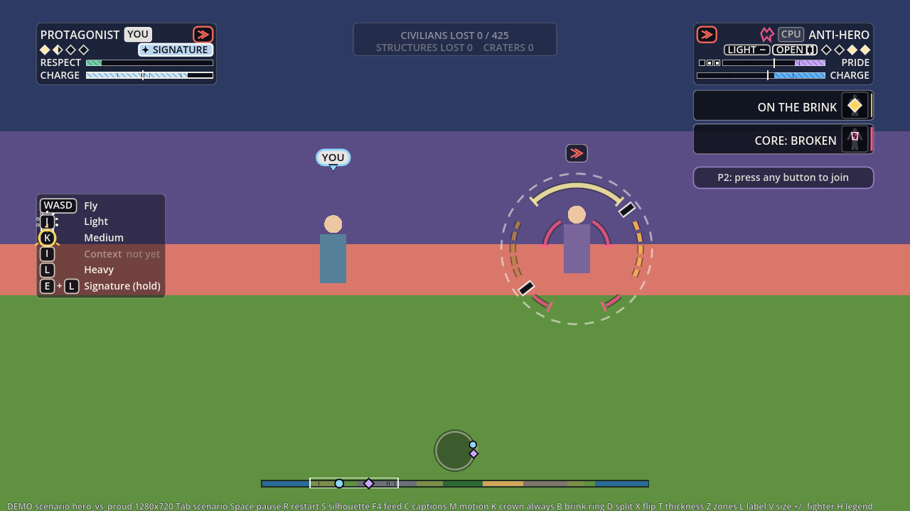
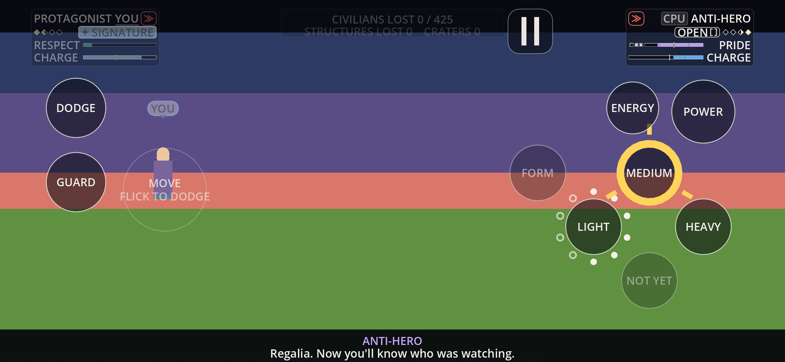

# The brawl's teaching marks: the nine cells, the perfect follow-up, and the small marks (UI, 2026-10-12)

Owner: UI & UX. **Paper only; nothing here is built.** Against `docs/design/brawl-second-pass.md` sections 15 and 16 and `docs/design/depth.md`; the cue names are the director's (`docs/director/brawl-c2.md` section 7) and the perfect's three cues Encounter will build in pass 3. Mock: kept local (`homework/mocks/ui/`).

*The teaching sheet (a mock of these marks) is kept local, in `homework/mocks/ui/brawl-teaching-mock.png`; it is not in the repo.*

## 0. The rules these marks keep

1. **A shape, never a hue.** Every mark is a ring, a pip, a bracket or a ray; the fighter's colour may edge it, never carry it (colour-blind presets change nothing here).
2. **Under 5,000 px** each at the 1024x768 reference (the sizes below), so none is a block; and **none changes state twice in a second as a block** (the rule in `hud_check` still stands; these are added to its list with their sizes).
3. **Only the close may flash,** and it asks the register the way a body flash does. A perfect's mark is a spark of thin strokes: no filled area change, so it asks nothing.
4. **Behind the flags, inert when off:** `three_strengths` for everything about strengths, and a new `perfect_followup` flag (features.json) for section 3, so the HUD can ship ahead of Encounter's pass 3.
5. **No tutorial wall.** What teaches is the button the player is already looking at (a ring on its glyph), and three one-line hints, each shown once (section 4).

## 1. The small marks (item 1; all from cues that arrive today)

| Mark | From | What the player sees | Size |
| :-- | :-- | :-- | --: |
| **Weight chip** | `blow` cue text: light, medium, heavy, bolt, blast, release (k 1 = a flurry blow, shown as the chip repeating once) | The plate chip names what was just thrown, for 1.2 s after the blow, then clears. It answers "what did my press throw": a Y he could not pay for shows LIGHT. A heavier blow's chip has a thicker edge (a shape cue); bolt and blast carry a bolt glyph | chip: about 3,000 |
| **A miss: OPEN** | `miss` cue (`gave_ground` or `reach`; the swinger is the actor, `n` ticks open) | On the swinger's plate, two brackets and the word OPEN for `n` ticks. **On the player's own side the Y glyph lights with three ticks** (a different shape from the launcher's lit B, which has four): the stop is the answer to a miss | bracket: 1,500; lit ring: 2,500 |
| **A bolt's land** | `energy_land` text bolt or blast, `source` hit, guard, armour, miss | A small glyph beside the energy button for 0.6 s: a filled dot (hit), a bar (guard), an arc (armour), a hollow dot (miss). `energy_reach` (the bolt in flight, `n` its landing tick) shows nothing on its own | 400 |
| **The launcher's close** | `launcher_close` text used or lapsed | By the plate's launcher mark for 1 s: a spent (solid) triangle for used, a struck-through hollow one for lapsed. The steady ready/resting mark and no countdown stand | 600 |

## 2. The nine cells (item 2)

One ring family per way of pressing, on the glyph of the button (the legend row on a pad or keyboard, the circle on Full touch). Three families, told apart by shape:

| | Tapped | Mashed | Held |
| :-- | :-- | :-- | :-- |
| **What shows** | **The window ring** (section 3): a thin ring with four compass ticks, closing on the glyph. It is the beat | **The run** on the target's plate: four pips, then a caret. Each unanswered blow fills one; the caret is the close. It belongs to whoever is being hit | **A ring by the glyph:** X's is a ring of ten dots, one lighting per blow, so the burst lights them fast and the pace lights one every 10 ticks; Y's and B's are the charge arc (a click at full: a thick closed ring with four ticks), B's with its second ring (armour) |
| **X** | ring, 10 ticks, worth 4 | run to four, the next closes | dot ring: burst, then a slow pace |
| **Y** | ring, 6 ticks, worth 6 | run, with the guard chip marking the double chip | arc to the click; at full, the close's mark (a double bracket) |
| **B** | ring, 14 ticks, worth 9 | run (it climbs slower) | arc with the armour ring; full = launch ready |

- **Priced out:** a press he cannot pay for shows the weight chip of what was thrown instead (section 1); no new mark.
- **The launcher's opening and its rest:** the lit B while a launch is ready (built), the steady mark, and the close's used or lapsed. **No 40 s countdown, as ruled:** nothing counts down in a fight.
- **Simple and phones:** one Attack button reads a hold as strength, so there are two ring families that cannot be confused: **the arc is how long it has been held** (notches at 12 and 28 ticks, built), **the closing ring is the window** (this paper). They can show together, the arc outside and the ring inside. A held X and a held Y are not on Simple (the director's, as the pairs are); the hold-to-flurry setting gives the first, and its dot ring shows on the button then.
- **Cue fields I need for the run:** the `blow` cue gains `run` (the target's run, 0 to 4) and `run_to` (blows to the close); today the strike beat has `flurry` and `close` but the cue carries neither.

## 3. The perfect follow-up (item 3; the cues are Encounter's pass 3)

**The three cues, and the fields I read:**

| Cue | Fields I need |
| :-- | :-- |
| `perfect_window` (open) | `actor` (the attacker whose hit landed), `target`, `text` the strength of the hit that landed (light, medium, heavy), `source` its cell, `dur` the window in live ticks as the player sees them (7, 8, 10, 12), `at` ticks until it opens (6 for a plain light's pose, else 0), `k` the chain so far (0 to 2) |
| `perfect_made` | `actor`, `text` the follow-up's strength, `source` the cell tapped (x, y, b), `k` the chain after it (a link counts double, so it may jump from 1 to 3), `n` the tick the follow-up lands, `link` 1 if a different strength, `close` 1 if it brings the chain to three |
| `perfect_broken` | `actor`, `k` what was lost, `text` why: `missed` (the window ran out), `early` (a press between the throw and the window), `stopped`, `staggered`, `timeout` (90 ticks) |

**What it shows (human fighter's side; the rival's chain shows pips on his plate, smaller, with no ring):**
1. **The window ring** appears on the three strength glyphs together (any may follow) when `perfect_window` opens, closes over `dur`, and goes. On Simple and touch it is on Attack and is for the release. Radius 1.15 of the glyph (so legend rows and Full touch's buttons never overlap). **Reduced motion:** it does not contract; it is a steady double ring for the window.
2. **A perfect:** the ring snaps shut and **a spark** (the closed ring and eight short rays, thin strokes, about 1,100 px of coverage inside a disc of 4,500) shows on the button for 8 ticks, and the chain advances. **It does not ask the flash register** (strokes, no area of changed luminance; at one every 10 ticks it would pass three a second if it were a flash, which is why it must not be). The body-side spark and the rising note are Rendering's and Audio's.
3. **The chain:** three pips under the attacker's plate name (14 px each, 66 px wide); a link lights two. The third is the close: a double bracket round the pips and the word CLOSE; **it is the only mark that may flash** (a mark Rendering and the register own).
4. **A broken chain:** the pips clear over 0.4 s with a small cross; the ring that had been open fades over 0.4 s after the window (a late tap lands on a faint ring: that is the "you were late" read). No sound from the HUD.
5. **Rumble** is an option: **"Rumble on a perfect"** (accessibility, default on, needs Vibration on), a short pulse for a perfect and a stronger one for the close; the HUD emits `haptic_requested(kind)` and the host plays it on a pad (Safari has no vibration API).
6. **Keyboard:** the same ring on the legend's rows (F, G, R today); nothing else differs.

**Colour-blind presets:** unchanged: no mark here is a hue. **Reduced flashing:** the close's flash is the register's to refuse; the HUD's close mark is static either way. **Sizes and toggles:** the window ring is under 3,000 px, a pip row under 1,500, a spark under 1,500 of coverage; the window ring changes state at most once per window (8 to 12 ticks) but it is a thin ring, not a block, and the block rule's list gets these only as "under the threshold" with their numbers.

## 4. What teaches (no wall)

Three one-line hints through the existing hint line, **each shown once per profile** (UiPrefs `taught`), only with Control hints on:
- the first window a human sees open: **"Tap as your hit lands."**
- the first charge held to the click: **"Held to the click: a knock-back."**
- the first miss by the rival: **"He missed. Medium stops him."**
Words are data (`terms.json` prompt). The marks above are what teaches the rest: the ring says when, the run says how close, the charge says how long.

## 5. Fighters in depth (item 4)

**The HUD needs almost nothing.** The pair stands at up to 30 degrees and is always drawn side by side; the camera dollies with it and keeps the fight clear (`city-in-depth.md`). So plates, columns, the legend and the touch controls are unchanged, and the YOU marker and the crown already scale from the fighter's height in pixels (`anchor_fn`'s `h`). Three small things, none blocking:
1. **The edge arrow stays as built** (an off-screen fighter); the camera's guarantee makes it rare.
2. **A fighter behind a building's opened floors** is on screen but occluded: if `anchor_fn` can say `occluded: true`, the HUD draws a thin dashed ring in his lane colour at the anchor (about 1,500 px) so he is found through the glass. Camera or Rendering to add the key; without it nothing changes.
3. **The ground mark under the pair** (Rendering's) may take the lane colours (`UiHud.lane_colors()`, built, and the colour-blind presets already remap them), nothing else from the HUD.

## 6. Build order, gates, and what I need

| Step | What | Behind |
| ---: | :-- | :-- |
| 1 | The weight chip from `blow`, the miss's OPEN and lit Y, the energy land glyphs, the close's used or lapsed (section 1) | `three_strengths` |
| 2 | The run pips and the dot ring for a held X (section 2) | `three_strengths` (the run needs the cue fields) |
| 3 | The window ring, the spark, the chain pips, the broken chain, the rumble option and signal, the three hints (sections 3 and 4) | `perfect_followup` (new, off) |
| 4 | The occluded ring (section 5), if the key arrives | none (inert without it) |

Gates for every step: `hud_check` including `_block_toggle_rules` and `_sim_untouched_rules`, `hud_words_check`, `determinism.gd` plain and `-- --intro --seeds=2 --ticks=900`; the new marks get cases (shape, size under 5,000 px, redraw counts at rest, the cues in and out of the flags, reduced motion). At most two Godot processes.

**Needs, to Encounter (through the EP):** `perfect_window`, `perfect_made`, `perfect_broken` with the fields in section 3; `run` and `run_to` on `blow`; `miss`'s `n` (it has it). **To Camera or Rendering:** the `occluded` key on the anchor. **To Controls or the host:** play `haptic_requested`.

## 7. Built (steps 1 and 2, 2026-10-12), behind `three_strengths`

 

- **The weight chip** follows the `blow` cue (`UiPlate.BLOW_HOLD` 1.2 s); **OPEN** (brackets) on the swinger's plate for the miss's `n` ticks, with the target's medium glyph lit with three ticks on a legend and on Full touch; **a bolt's land** as a chip with a shape (dot, bar, arc, hollow); **the run** as pips and a caret on the target's plate once the `blow` cue carries `run` and `run_to` (inert until then); **X's ring of dots** (ten, one per flurry blow, clearing 0.6 s after the last).
- **Where, differently from the mock:** the bolt's land is a plate chip (the plate is where a bolt's thrower is named), not a glyph at the energy button. **One chip beside the pips:** the most urgent of OPEN, the run and the land takes the weight chip's place; a human plate with SIGNATURE up has no room for any chip beside the pips, so the weight chip and the small marks show on the rival's plate and on the legend (open: take SIGNATURE's chip off the plate while one of these is up).
- **The launcher's close (used or lapsed)** is not built: `launcher_close` is read for the lit B but its text is not drawn; it comes with the steady mark's second look.
- **Tests:** `_brawl_marks_rules` (the flag off draws nothing; the chip says each kind and falls back; a miss; the lit medium and its redraw key; Full touch's lit button; a bolt's land; the run and the dots clear on time; the unread counter). hud_check 4,628 checks, 0 failed; hud words, pane, determinism plain and `-- --intro --seeds=2 --ticks=900` pass.
- **Demo:** `--three --blow=heavy --miss --land=armour --run=3 --dots=6`.
