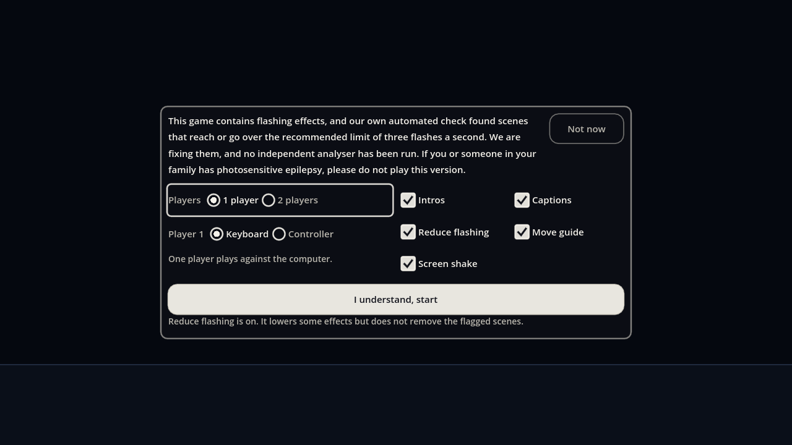
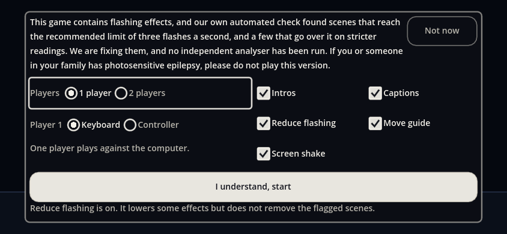

# The start menu (UI & UX, 2026-10-14)

Orb, 2026-10-14: "can we put a playable browser demo back up, with a disclaimer for the photosensitive if necessary? can we have a simple menu with basic controller options (1p, 2p, controller/keyboard, presented in radio buttons?) to set before beginning the fight? give some checkmark options to turn on/off settings like intros."

 

## What it is

The game boots to one card over a still dark background. **No match plays behind it or before it**: the match object exists, held, and not one tick runs (the same hold the flashing gate used; `SimHost.advance()` returns no ticks while it is held); the card is opaque. Nothing of the sim is touched until Start.

| | |
| :-- | :-- |
| **Top** | **Legal's notice (RL-136), exactly, with nothing playing behind it:** "This game contains flashing effects, and our own automated check found scenes that reach the recommended limit of three flashes a second, and a few that go over it on stricter readings. We are fixing them, and no independent analyser has been run. If you or someone in your family has photosensitive epilepsy, please do not play this version." Data: `terms.json` `prompt.menu_notice`; a test compares it word for word and checks the screen never says safe, tested or compliant. A quiet **Not now** sits at the top right (web only, first screen only): it goes back to the holding page (`prompt.menu_holding_url`; empty goes back in the browser's history). |
| **Radio buttons** | **Players:** 1 player (it plays against the computer) / 2 players. **Player 1:** Keyboard / Controller. **Player 2** (only with 2 players): Keyboard / Controller. **Computer** (only with 1 player, when the computer plays a side): Easy / Medium / Hard, Medium to begin with (2026-10-28). Both on the keyboard says they share it and the guide shows each player's keys (Controls' shared layouts). A Controller chosen with none connected says "No controller found yet. Press a button on it." |
| **Checkboxes** | **Intros** (on), **Reduce flashing** (ON by default), **Screen shake**, **Captions**, **Move guide** (the control legend). Only settings that already work: each is an existing option (`camera_shake`, `captions`, `control_hints`, `reduce_flashing`, and the intro through the match setup). |
| **Start** | One button, **"I understand, start"**, with Legal's small line under it ("Reduce flashing is on. It lowers some effects but does not remove the flagged scenes."; "Reduce flashing is off." when it is unticked). It applies the boxes (they are saved like the Settings screen's), files the choices in the prefs (`UiPrefs` key `menu`), tells the host (`menu_started`), and goes. |
| **Input** | Keyboard: Up and Down move between rows, Left and Right change a radio or a box, Enter or Space accepts, Tab goes down. Pad: the d-pad and A (B or Start goes Back mid-match). Touch and mouse: a tap sets any option, 48 dp targets. The flashing gate's rule stands: nothing but its own buttons starts anything. |
| **Remembered** | Everything above, in the prefs, so the card opens as it was left. |
| **Back to it** | The pause menu has a **Main menu** entry (a Back button returns to the match). **Three seconds after a match ends a Match over card opens** with Play again (the same choices), Main menu and Send feedback. |

Mid-match (from the pause menu) the notice is not repeated: Back takes its corner. Labels (fourteen, plain words, "computer" for the opponent, "Charge" not ki): Players, 1 player, 2 players, Player 1, Player 2, Keyboard, Controller, Intros, Reduce flashing, Screen shake, Captions, Move guide, Start, Back to the match.

## How it is wired (UI's side is built; the host line is yours to grant)

- `UiMenu` (plan, hit, draw), `UiHud.show_start_menu`, `menu_started(config)`, `features.json` `start_menu` (true; off brings back the old gate), the pause menu's Main menu entry and the Match over card. `hud_check` `_menu_rules`: the words, geometry at 14 sizes (every control a 48 dp target inside the card, nothing overlapping; below 600 CSS px wide only Start is promised), the keyboard, pad-button and tap flows, the saved choices, the boxes taking effect, Back, the pause entry and the Match over card.
- **`render/core/main.gd` (not mine): `docs/ui/start-menu-main.patch`**, 30 lines, tested on a clean export of main (it loads to the menu; Start begins the match): a connect in `_ready` and `_on_menu_started(cfg)`: `start_match(seed, {"p1": false, "p2": players == 1})` (with `{}` as the setup when Intros is off, the `--nointro` setup), then each human's device is claimed (a controller is the first connected pad, a second human the second; the keyboard otherwise).
- Boot: `UiHud.setup()` raises the menu where it used to raise the gate (the web, not a headless run, not a local tool's bypass words), so everything the gate did (the hold, the bypass rules on a public host, the first-run card waiting) is unchanged.

## What is left to you, Orb or Legal

1. Done: `prompt.menu_holding_url` is `"../"` (the holding page sits one level up; EP, 2026-10-14). Not now (web, first screen only) navigates there; if the value is emptied it goes back in the history, or to `/`.
2. Done: Reduce flashing is ON by default in all three places: `ui/data/options.json` (`default: true`), `ui/data/features.json` (`reduce_flashing: true`, so its Settings row is live) and the `ui_hud.gd` options literal. A saved choice still wins. Tools' shell page shows Legal's gate before the engine starts; the menu's notice is the second and stays (Legal's words).
3. The first-run How to play card still opens over the new match after Start (as before): keep it, or skip it when the visitor came through the menu (one condition).
4. Done 2026-10-28: the computer's level (Easy, Medium, Hard) is a row of the menu; see the section at the end.
5. Below about 600 CSS px wide (an iPhone SE in landscape with Safari's bars) the card cannot show every row at once; Start stays on screen.

## 2026-10-15: RL-137 sentence and the upright phone

- The notice's first sentence is Legal's RL-137 wording (data `prompt.menu_notice`; sentences 2 and 3, the button and the small line unchanged).
- At 390 px wide upright the radios ran under the boxes. The card now **stacks** when a radio row's two options cannot sit side by side in half the card: radios take the full width, the boxes go under them in two columns. When the long notice makes a short landscape screen too tall at the floor font, padding and gaps are halved before the layout gives up. `hud_check` now also tests that every label's text sits inside its own control at 19 sizes, five of them upright (390x844, 414x896, 768x1024, 1170x2532, 1080x2340).
- Stills: `img/start-menu-phone-portrait-web.png` (390x844), `img/start-menu-phone-web.png` (844x390), `img/start-menu-desktop-web.png` (1280x720).

## 2026-10-28: the computer's level

- **The row.** "Computer: Easy, Medium, Hard" under Player 1 (and Player 2), shown only with one player, since only then the computer plays a side. Medium to begin with; Left and Right move along the three and hold at the ends, Enter or Space cycles round, a tap on a choice sets it. The choices are the levels of `data/director/ai.json` in the file's order (`UiMenu.levels()`), and the default is that file's own `level`. Words: `prompt.menu_ai`, `menu_ai_easy`, `menu_ai_medium`, `menu_ai_hard`.
- **Saved and sent.** The choice is `ai_level` in the menu config (the `menu` prefs beside the fighters, so the card opens as it was left, and Play again keeps it). Start sends the config to the host with `menu_started`.
- **How it reaches the AI.** The host puts it in the match setup as `aiLevel` (`render/core/main.gd`: `_ai_level`, set when the menu starts, added by `_match_setup` so New match from the pause menu keeps it), and `SimCore` applies it when the match starts (`sim/core/sim.gd`, `_mHead`): the level becomes `DirAI.level`. Medium is the file's own level, so it is applied as "" and a Medium match is byte for byte the match of a setup with no level. Another level changes the data hash in the replay header (`DirAI.skillText()` already folds the level in), so a replay made at Hard is not mistaken for one made at Medium. UI never writes the sim: the level enters only through the setup, like the seed.
- **Checks.** `hud_check` `_menu_rules` (the row, its keys and taps, the save and reload); `ui/tools/difficulty_check.gd` (the sim reads the level, Medium is identical to no level, Easy and Hard differ, and the host's setup carries it through Start and New match).
