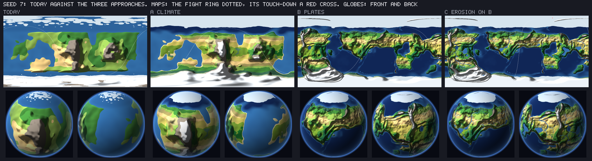
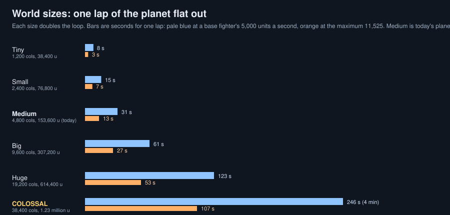

# The planet, engineered: a plan (World, 2026-11-01)

Orb (`docs/ep/vision.md`, last block): "I definitely want the planet and topography overhauled and engineered further alongside our locations, landmarks, etc." The EP asked World for the plan. **A plan only: no data changed, nothing built, nothing run.** Costs below come from Research's and World's earlier measures (marked), scaled where I say so. Art's and Legal's reads of the looks and limits (megastructures included) are still to come and get folded in here when they arrive.

Sources: `docs/world/canon-planet.md`, `docs/world/gen3-field.md`, `docs/world/ring-any-angle/world.md` (sections 12 to 14, the 128 ground), `docs/research/planet-gen.md` and `research/planet-gen/` (the pictures), `docs/world/planet-gen2.md`, `plates-b.md`, `rivers.md`, `outposts.md`, `home-set-pieces.md`, and Orb's words in `vision.md`.

## 1. Where the planet is today, seen from the fight

**What exists.** The planet is one function of a point: ground height, a biome, ice at the poles (`WorldPlanet.surfAt`). On top of it the team built, and parked behind switches:
- **Climate** (Research's A): temperature from latitude and height, wind-carried moisture with a rain shadow, and a table that picks the biome. Gives 11 to 15 biomes a planet.
- **Plates** (B, `plates-b.md`): ranges on plate edges, island arcs and trenches, rifts, hotspot chains, coasts that bend. **Shipped off** (`land.json` `b.enabled` false).
- **Erosion and rivers** (C, `rivers.md`): flow routed over the planet, rivers cut into the ring. **Shipped off** (`rivers.json` `enabled` false).
- **Gen 3, the field** (`gen3-field.md`): the sim's ground is a lattice of nodes on a cube-sphere, 128 units apart (a 512-unit bake read whole at load, the 128 nodes read on demand), joined by triangles, with crater and scar records laid on top. It is gen 2's ground, sampled; it does not add anything new to look at.
- **Places and landmarks:** cities, towns and outposts placed by rules over the same ground (`sites`, `outposts.md`, `canon-planet.md`'s Everhold); a landmark is a building with a `landmark` index (the Bell Tower; the hill chapel, which Legal bars as a target).

**What a player sees from a fight.** Three things Orb has said, and what I think is behind each:

| Orb | What I find | Whose |
| :--- | :--- | :--- |
| **Sameness** | Today's planet reads as a few smooth blobs of four or five colours (`compare-s7.png` below, left). A fight ring crosses a median of **4 biomes**; climate alone makes it 11.5. There are **no rivers** on it, no ranges with a spine, no coast with a shape, no basin or plateau; places are put where a rule finds flat dry ground, so a town has no *reason* to be where it is | The planet (World, Research's work built but off) |
| **Low detail** | The sim's ground is read every 128 units and the bake every 512, so a peak is rounded (up to 2.5 fighter heights at 512, half a height at 128), ice edges stop being walls, shores move up to 4 columns (`world.md` section 12). The "ground drawing in much higher than where my fighter appears to be" in Orb's old-PC test was not the planet or the tiles: that kit had no tiles at all and ran the old plain renderer (Performance's diff, Rendering's check) | The 128 ground is a cost choice (World); the old-renderer picture is Rendering's |
| **Hollow hills** ("the mountain with a house on the hill ... I can see the open interior of the hollow mountain") | **Not the planet.** The sim's ground has one height per column, so it cannot have an inside. What Orb saw is the picture: a tile, its skirt or a neighbouring level that disagrees, which is where the EP says Rendering's lead has gone. World's part is only that a pad or lot flattening a hillside (lot-terraces, lot-lean) makes a step the tiles must handle. A real cave or arch would need a feature of its own (section 3) | Rendering's tiles, World's pads |

*Research's picture for seed 7, the canon planet: today, then A (climate), B (plates), C (erosion on B). The globes below the maps are what a flyer sees.*

*The 4,800-column ring a fight happens on, same seed: today (top, four biomes, a flat shelf with one block of mountain, no river), then A, B, C. B and C have a coast with a shape, a range, valleys, ten or more rivers.*

## 2. What an engineered planet would have

The words "engineered" and "a designed reason each place sits where it does" ask for one change of order: **today places are found on the ground after the ground is made; an engineered planet makes a plan first, and the ground, the water, the places and the landmarks all follow from it.**

**The plan (a "blueprint"): a small map made first, from the seed, then everything is read off it.** It is the plates' map and the climate's grid we already have, with four more things written down as data, at a coarse scale (a cell of about 600 to 1,000 units: 40 to 64 across the planet, hundreds of KB at most):
1. **Landforms:** continents, seas, ranges with a spine and foothills, basins, plateaus, rift valleys, island arcs (B already makes these).
2. **Coasts:** which are bays, headlands, deltas, cliffs. A coast is a line (a record) not a threshold of noise, so a harbour is a real bay.
3. **Water:** rivers from the mountains to the sea, lakes in basins, a delta where a river meets a coast (C already routes these).
4. **Reasons:** for every cell, a short list of what the land is *good for* (a harbour, a ford, a pass, a spring, high ground, ore, flat fertile ground).

**A place then has a reason**, picked by a rule that reads the blueprint, and the reason shapes how it looks and what it holds:

| Reason | Where the blueprint puts it | What the place is |
| :--- | :--- | :--- |
| Natural harbour | a bay on a coast, sheltered by a headland | a port city (quays, cranes, a lighthouse on the headland) |
| River ford or bridge | where a river is narrow and the land either side is flat | a market town with a bridge landmark |
| Pass | a gap in a range between two basins | a fortified town or a toll tower |
| Confluence | two rivers joining on a plain | the hub city (Bellgate's role) |
| Mine | ore ground at the foot of a range | a works town (chimneys, slag, rail) |
| High station | a summit, a plateau above the clouds | an observatory, a relay mast, Rimewatch's cousin |
| Lakeshore, delta, oasis | the water record | a resort, a rice-town, a green dot in the desert |

So **a landmark is what the reason is made of**: the lighthouse is on the headland because the harbour needs one, the bridge is at the ford, the dam is in the gorge, and each is on ground picked to hold it (a flat enough shoulder: my opening and pad measures show 21% of the ground a fight can start on is steeper than 39 degrees, so the reason table also asks for slope).

**Landmark classes** (a class is data: shape, size, a recipe for the ground and the people, what is breakable; names are Narrative's, and Legal's no-school, no-hospital, no-worship rule stands for every class):
- **Civic and trade:** towers, bridges, lighthouses, falls and stairs (what `canon-planet.md` already names).
- **Natural:** a split mountain, a stone arch, a hot spring, a standing-stone field. A natural feature is ground, not a building, so it needs the ground to carry it (section 3: records).
- **Megastructures (Orb's spitball, "like giant space elevators, with a big red structure on them"):** a possible class, not a promise. See below.

**The megastructure class, in plain words (Legal's RL-233 sets its limits; the concept sheet is Art's and is still to be screened).** Orb liked them *because they were unexpected* and does not want the old ones carried over as they were. As a landmark class they are **unpopulated machine infrastructure**: a tether, a lift, a power or anchor structure, with no residents and no crowd at the foot. If a place near one has people, that is a share World sets for that place under RL-228 (a scalar into the hero's anguish, nothing else), not a feature of the structure. **No AI, picker or landing score reads one** (RL-213 to RL-217), so it is never a place a fight is steered toward. Three forms:
- **A tall tether or lift:** one very tall structure on a plain or a sea platform, rising past the cloud, with a static colour block on it (Orb's red structure is a good start; a top light, if any, is steady or no faster than 1 Hz, small and never a light show). It is a tall building: the tallest today is about 4,875 units, flyers reach 7,000 and the meteor about 6,600, so "to the top of the atmosphere" is above the fight's reach; the view draws it above the band and the sim has only its footprint.
- **An arc or span across the sky:** a thin band seen from many places and never touched. View only.
- **A raised platform or anchor island:** a structure fighters can fly round, perhaps through; needs a solid in the sim that is not ground, so it is the dearest and touches the sim's design most.
**Shapes to avoid** (RL-233, handed to Art before the sheet): no needle with a pod, saucer, ring, platform or lookout on top; no antenna mast, red-and-white striping, clock face or beams of light; no outline copied from a real tower; never two matching tall towers side by side (a pair differs in height and form, or is not a pair); no franchise sky-tower (a slim tower with a small temple on top), no ring-world or orbital-citadel outline; nothing that reads as a place of worship, a reactor, a cooling tower with a plume, a dome-and-stack, or a hazard sign. Names pass Narrative and the name checks, and use no real tower's or franchise name.
**If a fight can break one** (the question for Orb and Game Design), Legal's rule is that it falls like RL-232's block: one catastrophe-class light and dust event (one rise at least 0.3 s, one fall at least 1 s, a calm form, a local dust cloud, no ceremony or slow motion), and **never a straight-down pancake into a street cloud**: it breaks in sections, topples, or snaps at a tether or joint; no figure is ever shown falling from it; a space-high collapse is a debris event, with no wreckage falling on a crowd shown. The toll stays the existing scalar (no new count, line or reward). For World that means a breakable megastructure is built as **sections joined at named joints** (each a structure with its own hit points, the fall's order set by the joints, not by a place chosen), which is new to the building rules (a building falls whole today) and would be its own small park after Orb decides. If it never breaks, it costs the view only and the sim a pillar.

## 3. What fits the 128 ground and the load budget

The rule I would keep, from ADR 0012 and `world.md` section 14: **the expensive part is made once per planet at a coarse scale; the per-tick part is a lookup.** Fidelity is a setting of the match, not of the machine.

| Piece | When it is made | Cost (source) | Fits? |
| :--- | :--- | :--- | :--- |
| **The blueprint** (plates, climate grid, flow routing, reasons) | once, in the planet load job, time-sliced | A is 1.8x today's cost a column; B 3.4x in noise, 4.3x in JS time (about 40 to 50 microseconds a column in GDScript, against today's 10); C needs a planet grid, 69 to 153 ms in JS and an estimated 1 to 5 s in GDScript (`planet-gen.md`). At 600 to 1,000 units a cell that is hundreds of KB | Yes, as a load phase. A canon planet (Everhold) can be **cached** so the load pays nothing |
| **The ground nodes** (the 128 ground, the 512 bake) | once, in the load, by lookup after | The 512 bake is 34,656 nodes, 1.7 s native for today's ground (48 microseconds a node); a whole 128 bake is 458,400 nodes, 2.3 MB, 23 s on the web and 9 native **for today's ground**. **If B's cost a column is 4.3 times today's, my scaled estimate is about four times that:** the 512 bake would be 7 s native, a 128 bake 40 s native and about 100 s on the web. That is not a load | The 512 bake yes. The 128 ground **only if the blueprint carries the shape and the node read stays cheap** (below) |
| **Edges: coasts, cliffs, rivers, lakes** | as records over the ground | Coast about 8,000 vertices, cliffs about 1,100, rivers a few thousand: 64 KB to a few hundred KB, no per-tick cost (`world.md` 14.2) | Yes. Records keep a coast, a cliff or a river exact at any density, which is the answer to "low detail" for edges |
| **Places and landmarks** | with the blueprint, as data | Cheap: a record per place (hash by place id). A landmark is a building with a class | Yes |
| **View detail** (denser reads, a cubic filter, planet-keyed micro relief, drawing records at full density) | per player, view only | `world.md` 14.4: no sim cost, a granular setting | Yes: this is how a weaker and a stronger machine share one planet |

**What this means for the 128 ground.** The 128 lattice stays the sim's ground. The engineered shape lives in the blueprint and the records, and the node read samples the blueprint with its cheap parts (the cost of a node should stay near today's, not 4 times). The sim's ground is a height function: it can have ranges, valleys, cliffs and coasts and never a cave, an arch or a floating island. Those, and megastructures, are **structures and set pieces on top of the ground**, which is where the landmark classes already live.

**Gen and hashes.** A new generation is a new number (`gen 4`, behind a switch). Everhold changes under every approach (Research found it), so the open question in Orb's homework stands: **pin story planets to the old function, or re-canon.** I would re-canon, and re-run the names (`canon-planet.md`) over the new blueprint, because the reasons give the names something to be true to.

## 4. World sizes: tiny to COLOSSAL (Orb's order, 2026-11-01)

Orb: every match can get a new seeded, procedural globe, picked from **tiny, small, medium, big, huge, COLOSSAL**; tiny worlds are the way down for weak machines (ADR 0013, which removes the old laptop as a budget). **A plan only. Every number below is arithmetic from today's constants and from the measures in `gen3-field.md` and `world.md`; none was run.** Medium stays today's planet.

### 4.1 What is fixed today

In `sim/core/constants.gd` (all constants, so every planet is one size):
- **`PLANET_NC` = 4,800** columns round, and `COL` = 32 units a column: **153,600 units, about 2,050 fighter heights, a radius of 24,446.** The arena (`SimConst.NC` and `W`) is already a per-match number (`setArena`, set at the top of `newMatch`, 600 to 4,800 columns, a multiple of 8), so a ring smaller than the planet already plays; one bigger does not.
- **`PS` = 16** (9,600 x 16 = the same 153,600), **`WS` = 8** and **`MS` = 12**: the **hand-made world** (gen 1) is laid in "original planet" units times `PS` (towns, `START_X` = 5,600 x `PS`, the segments of `terrain.gd`, `settlements.gd`, `biomes.gd`, `cover.gd`, `plan.gd`, `location.gd`, `ai.gd`: 42 uses in 11 files). **The hand-made world stays a medium world**; a size picker applies to the procedural planet (gen 2 and gen 3) only.
- **`PLANET_NC` is read in 20 files.** The planet radius `PLANET_NC x COL / 2 pi` is written out in six places (`sim/core/field.gd` `R`, `store.gd`, `waterrec.gd`, `collateral.gd`, `contact.gd`, `sim/world/field.gd`), `planet.gd` sets `P.L` from it, `ringpick.gd` scales every ring by `cols / PLANET_NC` and tests "whole" against it, `sim.gd` bounds the arena by it and sizes the load's phase count from it, `campaign.gd` takes it as the default ring, and `render/core/planet_view.gd` counts the planet's copies from it.
- **Data sized to the medium planet:** `field.json` `cells` 300 (a face edge is 38,400 units, so 128 units a cell, and a 4-step bake at 512), `planet.json` `cities` 12 and `towns` 44 (minimum 2 cities; a seed 7 planet lays 11 and 31), the climate and flow grids (192 x 96 for rivers), the store's box and reach.
- **Not planet-sized, and staying so:** `COL` 32, the fighter (75 units), the tallest building (4,875), `CEILING` 24,000, the lanes, `BOOST_NEAR` and `BOOST_FAR`, every speed. These are absolute, so **a bigger planet is more distance at the same speed, and a smaller one is less**.

### 4.2 The six sizes

I propose each size doubles the loop (so the names mean something you can say aloud) and **medium is exactly today's**. A column is 32 units; a fighter is 75.

| | Tiny | Small | **Medium** | Big | Huge | COLOSSAL |
| :--- | ---: | ---: | ---: | ---: | ---: | ---: |
| Columns round | 1,200 | 2,400 | **4,800** | 9,600 | 19,200 | 38,400 |
| Units round | 38,400 | 76,800 | **153,600** | 307,200 | 614,400 | 1,228,800 |
| Fighter heights round | 512 | 1,024 | **2,048** | 4,096 | 8,192 | 16,384 |
| Radius, units | 6,100 | 12,200 | **24,400** | 48,900 | 97,800 | 195,600 |
| Surface, against medium | 1/16 | 1/4 | **1** | 4 | 16 | 64 |
| **One lap flat out, base (5,000 a second)** | 8 s | 15 s | **31 s** | 61 s | 123 s | 246 s |
| One lap flat out, maximum (11,525 a second) | 3 s | 7 s | **13 s** | 27 s | 53 s | 107 s |

(Speeds are Game Design's from `power-scale.md`; they are absolute, so a lap goes with the loop.)

### 4.3 What each size does to the fight

- **Flight time.** As the table: a tiny world is a lap in 3 to 8 seconds, so a base fighter can be anywhere in a breath and the planet reads as a small moon; a COLOSSAL one is two to four minutes round, so the "I flew round the whole planet" moment Orb wants at maximum power is real work. Pillar 3 (never out of range) is automatic on tiny and has to be earned on big ones.
- **Launches.** A send's reach is set by its speed, so it does not change with the planet; what changes is what it reaches. A rough ballistic reach (speed squared over 1,000 a second squared, no drag, no travel factor; Simulation to measure) is about 6,600 units for the base send (2,570 a second) and about 49,000 for a 7,000 send. Against the loop: base is 17% of a tiny world, 4% of a medium and 0.5% of a COLOSSAL; maximum is more than a lap of a tiny world (128%), a third of a medium (32%) and 4% of a COLOSSAL. So **on tiny every send can land anywhere (the arrival choice is nearly free); on big, huge and COLOSSAL a base fighter's arrival can only be a place near him, and the planet "opens up as you power up"** (Game Design's line) far more than today. This needs enough places within a send's reach at every size (next point).
- **Places.** Places are laid by count (12 cities, 44 towns, at least 2 cities) over the whole planet. Keeping today's spacing means the count goes with the **area**: cities 2 (the minimum), 3, **12**, 48, 192, 768; towns 3, 11, **44**, 176, 704, 2,816; buildings at every place (today about 3,900 on 54 places on planet 7) **244, 975, 3,900, 15,600, 62,400, 250,000**. The other choice is to keep the counts, which leaves the big worlds mostly sea and ground (a long way between places, and a base fighter can reach none). That is Game Design's call; I would keep the spacing and lay places **only where they are needed** (4.4 item 4): the sim cannot hold a quarter of a million building records.
- **Swing.** A swing turns the fight's line by an angle; the ground swept along the line goes with the radius, so **the same 70-degree swing sweeps 8 times as much ground on a COLOSSAL world as on a medium** (about 30,000 units of ring at medium, 240,000 at COLOSSAL, 7,500 on tiny). The ring reads (about 4 a tick on the web, `world.md` 11.3) are the limit, so on huge and COLOSSAL worlds a swing is either slower in ground terms (a smaller angle a second) or reads from a bake read ahead. Game Design's swing numbers are in degrees a second and keep working; the read budget is World's and Simulation's.
- **Load time and memory.** Whole-planet bake at today's 512-unit spacing, from `gen3-field.md` (48 microseconds a node on this PC, native; 5 bytes a node): nodes **2,166; 8,664; 34,656; 138,624; 554,496; 2.2 million**; load **0.1 s; 0.4 s; 1.7 s; 6.7 s; 27 s; 106 s**; memory **11 KB; 43 KB; 173 KB; 0.7 MB; 2.8 MB; 11 MB**. The canonical 128-unit nodes are read on demand (543,606 if the whole medium planet were read, 3.3 MB; times the surface factor, that is 13, 52 and 209 MB at big, huge and COLOSSAL if every one were read, which a fight never does; a cap on what is kept is needed). The **planet make** (today 1.2 to 1.9 s of a cold match start, most of it the climate and flow grids) grows with its grids: with a fixed cell size it goes with the area (64 times at COLOSSAL, more than a minute), so the grids keep their cell **count** and the finer detail comes from the node read, as in section 3. **The per-column state** (35 bytes a column) is for the arena's ring: **42 KB, 84 KB, 168 KB, 336 KB, 672 KB, 1.34 MB** if the arena is the planet's whole great circle.
- **Tiny's own problem: the ratio of the world to what stands on it.** A tower of 4,875 and a mountain of 6,000 (`MS` 12) against a tiny radius of 6,100 are almost the size of the planet, and the flight ceiling of 24,000 is four planet radii. Tiny wants its relief and its tallest building capped to a share of the radius (Art's and Game Design's look call, not a sim number yet), or it reads as a ball of spikes.

### 4.4 What must change in the sim, the netcode and the hashes

1. **Planet size becomes a match setting.** `PLANET_NC` becomes a variable like `NC` (a `setPlanet(cols)` at the top of `newMatch`, before `setArena`, with `COL` unchanged), and the six written-out radii, `P.L`, the ringpick and campaign defaults, the arena's upper bound, the load's phase count and the renderer's copy count all read it. **Medium is byte for byte today's: every golden, the parity run, the determinism, two-state and frame checks must pass unchanged at 4,800.** `PS`, `WS` and `MS` stay constants and the hand-made world stays medium.
2. **The size is in the key.** The setup (`planetSize`), the replay header, the state hash's data domain (`WorldPlanet.dataHash(gen)` already ends in the field's hash; the size and the generator's grid counts join it), the netcode handshake (both peers must name the same planet, seed and size before tick 0) and the save of a planet (a story planet's id carries its size). A replay on another size is refused, as one on another field is today.
3. **The generator reads the size.** `planet.json` counts by area, the grids keep their cell count (so the make stays flat), `field.json` `cells` goes with the size so the 128-unit nodes stay 128 units (the cache key and the bake's hash carry the size), and landforms scale in length and not in height (a range is longer, not higher).
4. **The sim holds only what is near.** Past big, buildings at every place and the far land cannot all be state. Places are laid **where the fight can reach them** (a window about the ring and the launch reach), by a rule that depends only on the match's setup and the tick, so every machine realises the same set (the front limit and index band are a first small form of this). This is the hard part, for Simulation: a window that depends on anything but the setup would fork.
5. **The arena ring.** For a great-circle ring the state grows with the planet (1.34 MB at COLOSSAL, against 168 KB at medium), and Netcode's rollback keeps many copies. The smaller ring (`setArena`, 600 columns up) already exists: **my suggestion is a great-circle ring up to big (9,600 columns, twice today's state), and a ring capped at 9,600 columns on huge and COLOSSAL**, with the swing and arena shift carrying the fight round the world. Game Design decides whether the "fly a full loop" goal needs the whole great circle on the biggest sizes; if it does, Netcode must price the snapshot first.
6. **Bake spacing is a match setting.** 512 units up to big; **1,024 on huge and 2,048 on COLOSSAL** keeps the bake at 138,624 nodes (6.7 s) and costs forecast fidelity only (the near ground stays canonical, with the records). It goes in the key with the size, so a replay reads the same ground.
7. **Rendering and Camera.** The globe view's copies, the horizon and the far plane on a world 8 times bigger or a quarter the size; the camera's zoom-out "returns to the globe"; the minimap. Not World's, but they read the size.

### 4.5 In what order to build it

0. **Decide (Orb and Game Design, before any code):** the six sizes (doubling, as above), place density by area or by count, the ring cap on huge and COLOSSAL, tiny's relief cap. One page, no build.
1. **Planet size as a variable, medium unchanged** (World and Simulation): item 1 above, proved by every gate unchanged at 4,800. No new size is playable yet. *This is the gate for everything.*
2. **The size in the key, the header and the handshake** (Simulation, Netcode): item 2, with a negative control (a replay at another size is refused).
3. **Small and big first** (the two nearest medium): the generator reads the size (item 3), places by area, the 512 bake; measure the load and memory against the table on Orb's PC and the GTX 1080 PC; look gate on each.
4. **Tiny** (Art's relief cap) and the weak-machine path: the cheapest world, the one ADR 0013 names.
5. **Huge and COLOSSAL:** the windowed places (item 4), the capped ring (item 5), the coarser bake (item 6), the swing's read budget; Netcode prices the snapshot; QA reads the civilian band at each size.
6. **The picker** (UI) and the per-size tuning of speeds and launches (Game Design), last: a size is only worth picking once it plays.

**What stays out of this plan:** the size of a fighter, the column width, any speed (absolute everywhere), and the old laptop (ADR 0013). A size is not a quality setting: a weak machine picks tiny and gets a smaller game, not a worse-looking one.

## 5. Options, with a pick

**Option 1: turn on what is built.** Switch on A (climate), B (plates) and C (rivers), re-tune by eye, put the sites on the new ground. Cheapest and mostly done, the pictures above are its result. Gives variety (4 to 11 biomes a ring), ranges and rivers. **Does not give a reason for a place**: sites are still found on the ground. Its load cost (B's 4.3x on every node) is the weak point and is not yet solved.

**Option 2: engineer in layers (my pick).** Build the blueprint described in section 2 from A, B and C as its first three layers, **moved off the per-node read onto a coarse planet grid read once at load**, add the reasons and landmark classes, and lay the coasts, cliffs and rivers as records. The ring's per-node cost stays near today's; the load pays a few seconds for the grid (cached for canon planets); places and landmarks come with their reason. This is options 1 plus the order change.

**Option 3: author the canon planet by hand.** Everhold drawn by Art and Orb, region by region, with the generator used only for random planets. The best-looking canon, the most work, and it leaves the generator to catch up. Worth keeping as a later layer on option 2 (a hand blueprint is the same data as a generated one), not as the first step.

**Pick: option 2, in five steps, each one shippable and each behind a switch**, each through the look gate (ADR 0010: side-by-side against the reference, flash clips both modes):

1. **The blueprint and the cost.** Port the planet-gen A and B to a coarse grid with the node read cheap; measure the load and the node cost on Orb's PC and the GTX 1080 PC (ADR 0013: no old-laptop target; weak machines get a tiny world). *The one number that decides the rest.* Done when a 512 bake loads in a few seconds and a node read is at most 1.5 times today's.
2. **Relief and edges.** Ranges with spines, basins, plateaus, and coasts and cliffs as records (the ice-wall and peak losses in `world.md` section 12 come back through the records). Pictures against the reference.
3. **Water.** Rivers and lakes from the grid (C), deltas, a river's mouth in a bay. (The lake and river code exists: `rivers.md`, `lakes`.)
4. **Reasons and landmarks.** The reason table, the landmark classes (civic, natural as records, and any megastructure Orb picks), Everhold re-canoned and re-named; each place carries its reason for Narrative and Art.
5. **Set pieces that the ground cannot hold** (arches, caves, sky-islands, a megastructure) as structures with their own footprint, if Orb wants them, after Art's and Legal's reads.

What it asks of others, so the EP can brief: **Rendering:** the tile work (skirts, level disagreements) that Orb's hollow hill is, before any new ground; records drawn at full density. **Art:** the looks of a coast, a range, a river, a place's reason, and the megastructure. **Narrative:** the names over a new blueprint. **Game Design:** whether a megastructure breaks, and how places at a reason are used by the director (no picker reads people: RL-213). **Performance:** the load and node-cost numbers in step 1 on the two real machines. **Legal:** each landmark class and the megastructure, once, before step 4.

## 6. What I have not measured

Section 4 (sizes) is arithmetic from constants and earlier measures, not a run. Everything in section 3 about B's cost on the node is scaled from Research's ratios, not measured on the gen 3 field; step 1 exists to measure it. The cause of the hollow hill is Rendering's to confirm; I say only that the sim's ground cannot hold it. Nothing here was run: the quiet window forbade a Godot run and this is a plan.

## 7. Questions for Orb (plain words)

1. Do you want the planet's **ranges, rivers and coasts with real shapes** (what the pictures above show for B and C), even if it changes how Everhold looks?
2. **Everhold stays the story world, re-drawn** (my pick), or the old Everhold is kept as it is and the new look is for other planets?
3. **Megastructures** (unpopulated machine structures, no people at the foot, never a place a fight is steered to): something you can never break, or something that falls in a catastrophe, in sections, at a joint? And should a fight ever happen *on* one?
4. Do you want to **see one new planet's pictures first** (step 1 and 2 on seed 7 beside today's) before anything else is built?
5. **World sizes:** are the six sizes (each twice the last round, medium today's) the ones you mean? On the biggest worlds, do you want the whole great circle always to be the fight's ring, even if that costs more netcode work, or is a long ring that the swing carries round the world enough? And should places keep today's spacing on big worlds (many more places, laid only where the fight can reach them)?
