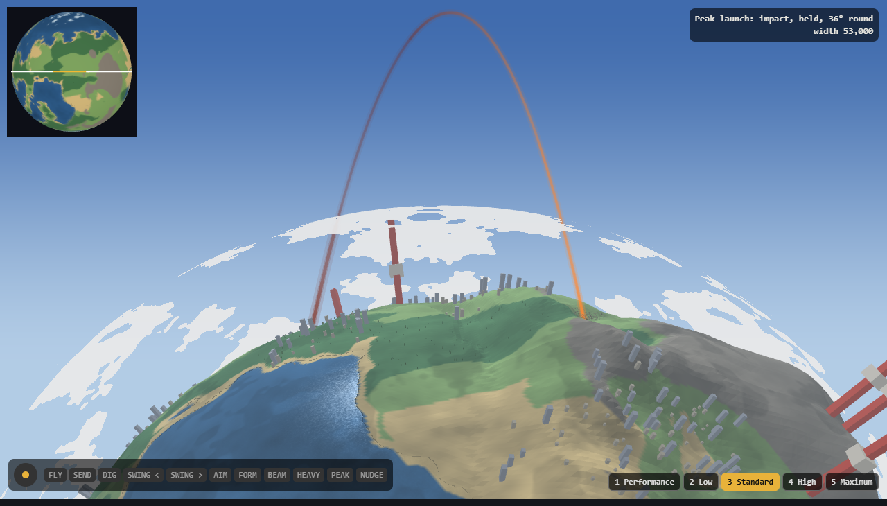

# The meteor's arc: one curve, written down

Research & Prototyping, 2026-11-01, on Orb's note: "the arc doesn't fully complete, the knocked-back fighter reaches the apex then drifts, and then stops and goes straight down". For Simulation and Encounter to follow. **Play it:** `research/ring-any-angle/proto-v2.html`, key M or RB+Y. **Reference code and table:** `node research/ring-any-angle/meteor-arc.mjs`.

**The default is Game Design's curve (`docs/design/rule-of-cool-map.md` §2): one formula from launch to contact, landing 60° round. The EP closed this on 2026-11-01.** It's measured, and it's the bigger shot Orb described. My parabola stays on a switch and a key (J, or D-pad up), and Orb's eye decides from here.



**How far to trust this.** Measured in the proto: the shape and the in-frame share. By arithmetic: everything in the sim's terms. Nobody has played this version, and none of it has run in the game.

## What was wrong, and it isn't only the proto

**In the proto,** the flight was three pieces: a climb, a hang and a drop, each with its own height and its own distance rule, meeting at corners. The drop covered the last 5% of the distance. That's the drift, the stop and the straight fall.

**The game's own law does the same thing, so fixing the proto alone would have moved the fault into the build.** `stepLaunched` multiplies sideways speed by 0.55 a second and leaves the climb alone, so he spends his carry on the way up:

| Send, today's law | Apex | Carry spent by the apex | Comes in at |
| :--- | ---: | ---: | ---: |
| 6,600 at 60° (the meteor's old send) | 16,300 | **97%** | **90°** |
| 7,000 at 60° | 18,300 | 97% | 90° |
| 7,000 at 45° | 12,200 | 95% | 90° |
| 5,000 at 45° | 6,200 | 89% | 89° |

`SimFlight`'s curve doesn't help: it paces the same path. **So this launch can't run on that law.**

## The curve

Game Design's, as ruled, with the proto's reading of it. `H` is the apex above the launcher's ground, `D = 1.551 H` the carry, `g0` and `gL` the ground at launch and landing, `t` from 0 to 1 over the flight's `T` ticks, and `c` the apex's share of the time (3.6 s of 6.2 is 0.581).

```
u_a = 0.5805                                    where along the ground the apex falls
e   = tan(pi/4 (1 - t/c))                       t before c
e   = tan(pi/4 (t - c) / (1 - c))               t after c
u   = u_a (1 - e)                               before
u   = u_a + (1 - u_a) e                         after

w   = u - 0.328 u (1 - u)
s   = D u                                       along the line, from the launch point
y   = g0 + (gL - g0) u + 4 H w (1 - w)          height, the ground under it passing from launcher's to landing's
```

**Game Design writes the pace as `du/dt = k (1 + e^2)`. That integrates to the tangent above,** so it needs `tan` (sine over cosine, on our own trig), not only polynomials as §2 says. With `c` 0.581 the two sides' `k` differ by 0.3%, so I give each side its own and they meet at the apex. The `(gL - g0) u` term is mine: §2 doesn't say how the ground enters, and this lands him exactly on it.

**On the ladder**, the proto uses the same formula on every row. Game Design rules the top two first and reads rows 2 and 3 against the tests.

| Lower tier | `H` | `D` | Round a Whole ring | `T` |
| :--- | ---: | ---: | ---: | ---: |
| 1 | 700 | 1,086 | 2.5° | 1.28 s |
| 2 | 2,500 | 3,878 | 9.1° | 2.42 s |
| 3 | 5,000 | 7,755 | 18.2° | 3.42 s |
| 4, not a meteor | 9,900 | 15,355 | 36° | 4.81 s |
| **4, the meteor** | **16,400** | **25,436** | **59.6°** | **6.2 s** |

Half and Close rings scale `H` and `D` with the ring, so the angle round holds.

## Against Game Design's tests, measured in the proto

Top tier, planet 7, flown at the proto's Standard level.

| Test | Limit | Game Design's curve | My parabola (36° round) |
| :--- | ---: | ---: | ---: |
| Slowest sideways speed against the mean | At least 0.5 | **0.79** (3,221 to 6,373 u/s) | 0.48, fails |
| Fastest turn against slowest, 10% to 90% of the flight | **Dropped by Game Design;** the tests are no corner, no reversal, never stopping | 1.8 (23 to 42°/s) | 10 (7 to 68°/s) |
| Doubles back, or stops | None | **None,** slowest sideways 3,221 u/s | **None,** slowest sideways 1,125 u/s |
| Foe in frame, descent | At least 90% | **113 of 120, 94%** | 120 of 120 |
| Foe in frame, hang | | 72 of 72 | 72 of 72 |
| Foe in frame, climb | | 145 of 180 (the first 0.6 s, as Camera expected; the trail stays in frame) | 145 of 180 |
| Speed jumps between ticks | None | Largest step 441 u/s, at 20,000 u/s or so | 250 |
| Two runs, one hash; a rollback across it | | **Not tested:** the proto has no hash | |

Speeds as drawn: leaves at about 13,600 u/s, slowest about 5,800 at the crest, and arrives at about 21,700. The crest reads faster on screen than Game Design's 3,200 because he's far out from the planet there: 3,221 along the ground is 5,400 at that height. **So the hang is a sweep rather than a float, and Orb should judge that first.** The crest-time slider moves it, and a slower crest is one number in `e`.

**Game Design's horizon question is answered: the landing at 60° round clears it.** Over the midpoint at the hang, the camera is 10,119 above the ground against the 3,733 that sight line needs, and it clears the planet by 4,609 units on every hang tick. Both fighters and the landing point are in the picture on 72 of 72 hang ticks, and he and the landing are in the picture on the last tick of the flight. It is on the limb, though, so an impact reads less head-on than at 36° round (`img/meteor-arc-parabola.png`).

**The parabola at Game Design's other distances, same reads:**

| Leaves at | Lands | Hang | Descent in frame | Both at the crest | Impact in frame |
| ---: | ---: | ---: | ---: | ---: | :--- |
| 60° | 36° round | 72 of 72 | 120 of 120 | 72 of 72 | Yes |
| 51° | 48° round | 72 of 72 | 120 of 120 | 72 of 72 | Yes |
| 43° | 59° round | 72 of 72 | 113 of 120, 94% | 72 of 72 | Yes |

All three pass Game Design's frame test.

**Two camera changes for Camera to check,** both in the proto's descent:

- The focus passes smoothly from the pair to just short of where he's going, as the width stops holding both of them. It removes a lurch, and the impact stays in frame.
- The width follows his height with a margin of 1.25, because he comes in faster and stayed at the frame's edge. His 7 lost ticks are 1.5 s into the descent, near the top of the frame.

## For Simulation

- **This launch doesn't step `stepLaunched`.** While he's on the curve, `x` and `y` come from the closed form of `(live ticks since the send, x0, side, D, H, g0, gL, T)`. Nothing accumulates, so a re-run lands on the same bits, and a read at any tick is one evaluation. Those numbers are constant for the flight, so they can be hashed once. Hit-stops don't advance it.
- **Only `+ - * /`, sin and cos,** in float64 on our own trig.
- **`y` is height along the flat line,** as the sim's world has it, and the curve over the planet is the view's. So the arc's roundness on screen comes from the view's mapping and needs nothing from the sim.
- **The ceiling isn't touched:** 16,400 is under 24,000.
- **Contact ends the flight.** From the apex on, the first tick with `y` at or under the ground is the landing, wherever that is, so a mountain in the way takes the meteor. He never skims along the ground to reach the planned spot; that was the last kink I removed. Towers follow §2: he goes through by tier 4's ladder and stays on the curve.
- **Leaving the curve** (the brake from the end of the hang, or a catch): §2 says on its current heading. The velocity is the difference of two evaluations a tick apart, so it needs no second formula.
- **Rollback:** by my reasoning, no new state beyond those constants and a flag. Netcode's check should say.

## For Encounter

- **The forecast is cheap.** The landing is at `x0 + side * D`, or §2's three candidates at 85 to 100% of it, known at the send, one ground read each. `predictFlight`'s 240 ticks aren't needed. Check the descent against the bake for an earlier contact; I'd sample every 500 units or so, about 25 reads, not measured.
- **A planned rest** (`restBy`) is about `T - 31` ticks from the send, or earlier if the check finds a mountain. No swing runs in this shot, so it's only a guard.

## Sliders for Orb

- **The arc:** Game Design's, or the parabola to compare: the switch, J, or D-pad up. The parabola is a quadratic Bézier with its own clock, in `meteor-arc.mjs`, with sliders for the angle it leaves at (43 to 85°, which reaches 60° round), its lean and its launch pace.
- **Crest at:** seconds of the 6.2. It works on both.
- **Top of the ladder,** which sets `H` and so `D`.

## Open

- **Should ordinary high launches lose this fault too? I think so, and it's Game Design's and Simulation's call.** Game Design keeps them physics for now. Any launch high enough for the player to read its shape still falls straight down at the end. Less sideways drag on a launch is one data value, but it moves carry, so it moves the golden behind its switch and every launch forecast. Not costed.
- **A slanted impact wants a slanted crater and blast.** A 74° arrival with a round crater may look wrong now that it's visible. World's and VFX's.
