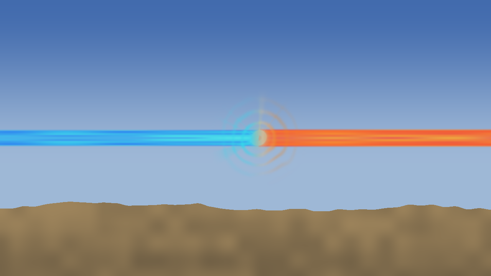
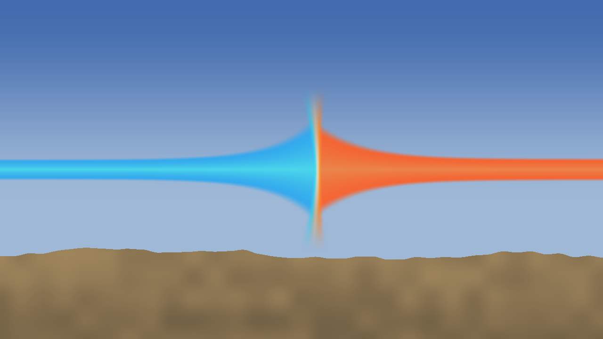
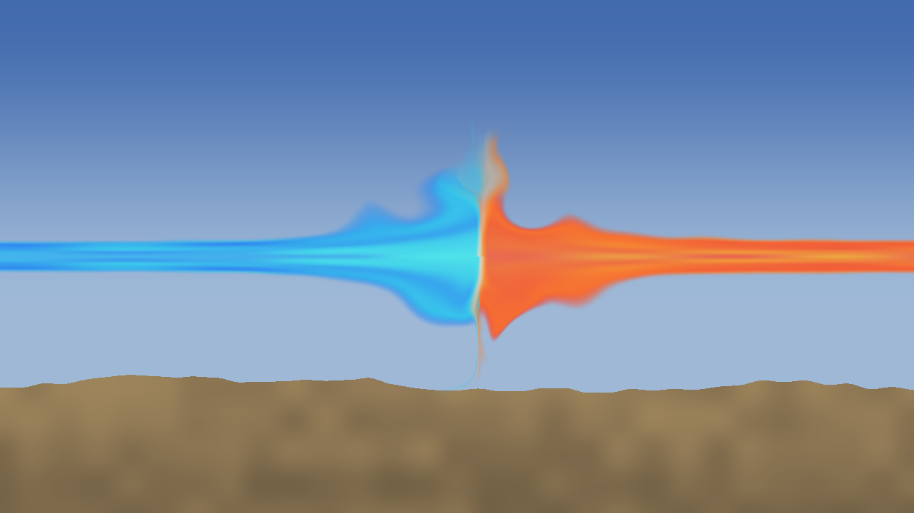
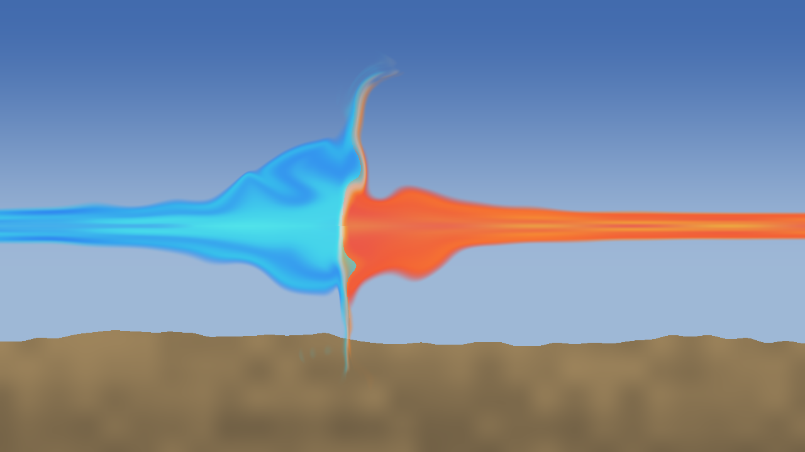
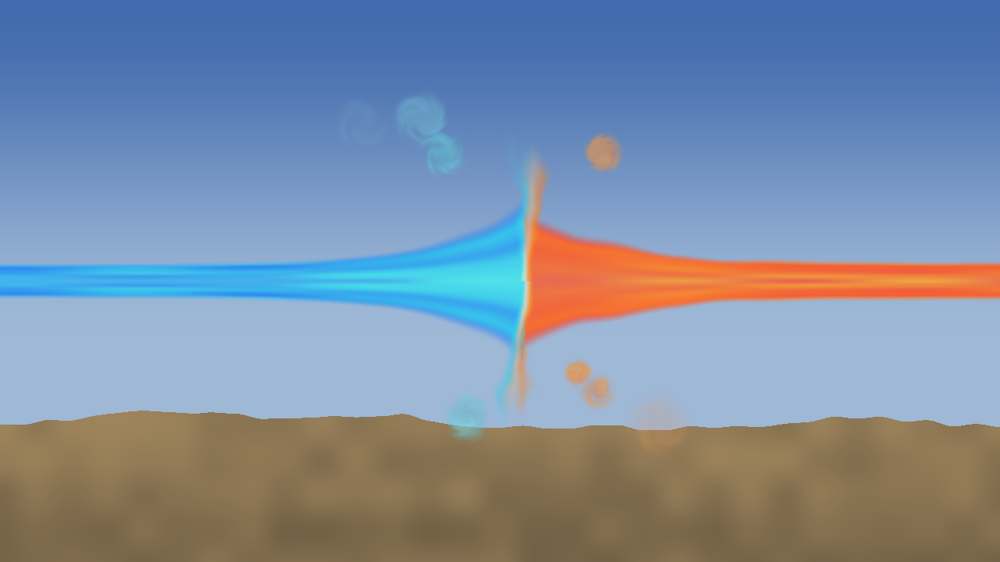
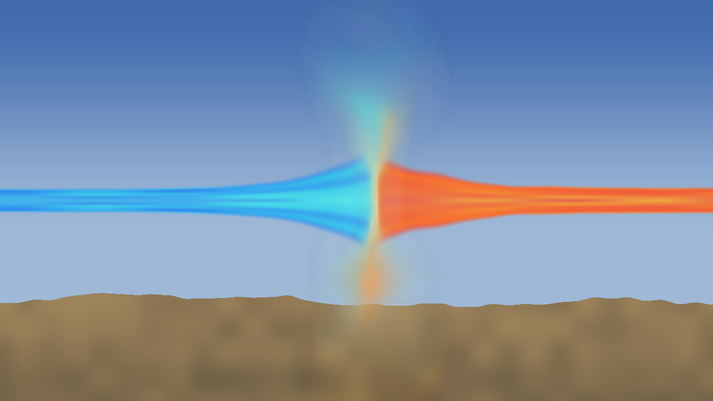

# Beam contact: making two beams look pressed together

Research & Prototyping, 2026-11-01, for VFX. Orb: "they do look like they are colliding and pressed against each other at the center point of the beam struggle, beam shape should flare out or erupt in eddies." **Try it:** `research/rule-of-cool/beam-contact-test.html`, keys 1 to 8. **Costs and flash count:** `node research/rule-of-cool/contact-bench.mjs [--igpu]`.

**Recommendation: build it in three layers, each useful alone.**

1. **Flare (A):** each beam's width swells as it nears the contact.
2. **Sheet (B):** a thin bright line where they meet, spreading sideways and breaking up at its ends.
3. **Stateless curl (C):** the flare's and sheet's shapes are pulled through a moving field, so their edges roll into eddies.

**The first two say "pressed together" and are the old-laptop path. The third says "erupts".** VFX's composition and air stay. Nothing here needs a new render pass.

| Today's disc | Flare and sheet, no noise (the lite path) |
| :--- | :--- |
|  |  |

| Flare, sheet and curl | The same at full power, the left side ahead |
| :--- | :--- |
|  |  |

**How far to trust this.** It's a one-page test on a flat side view with stand-in beams, not the game's. I judged it from stills and numbers, not in motion, and nobody else has seen it. Nothing has run in Godot. **Orb's eye and the look gate decide.**

## What real sheets do

Two opposed jets don't overlap. Between them is a stagnation point where the flow has nowhere to go, and four things follow, all usable as a visual grammar:

- **The jets widen before they stop,** because the flow slows and turns. That's the flare.
- **The flow escapes sideways as a thin sheet** across the contact. Water jets do it, and so do colliding plasma jets, which form a dense layer between standing shocks.
- **The sheet's rim is unstable.** Where fast flow slides past still air, the shear rolls up into vortices, and the rim breaks into fingers. Those are the eddies.
- **The stronger jet dents the weaker one,** so the contact bows toward the loser. Backflow also curls round each jet's head, like a mushroom cap.

So the eddies belong **at the rim and along the flare's shoulders, not all over a disc.** That's the difference between this and rings round a point: rings say something radiates from there, and a flare and sheet say two things are shoving at it.

## The techniques

Costs are the extra to draw a 400 x 400 pixel patch at the contact, on this PC's Radeon iGPU, over a backdrop of about 0.5 ms. **The machine was at 68 to 100% load, so these are rough ordering and invalid under the rule of 2026-10-12.** Performance's quiet bench is the measure.

| | A: Flare | B: Sheet with warped noise | C: Stateless curl | D: Eddy puffs | E: Small feedback texture |
| :--- | :--- | :--- | :--- | :--- | :--- |
| **Looks like** | Beams trumpet into each other and the contact bows. Clearly pressed, and no eddies | A also has a broken bright line and a torn rim. **Enough to read as a collision** | **Real rolled-up, mixing shapes;** the silhouette itself erupts | Detached whirls beside the beams. They read as smoke rings, not as part of the beam | Soft, glowing smoke behind the contact. It loses the hard pressed edge |
| **How** | A width function of distance from the contact; in the vertex shader on the mesh, or in the contact quad | One fragment function: flow along the sheet, one domain warp, two noise reads a pixel | Walk each pixel back through a curl field 3 times, then read A and B at the end | Up to 16 small soft blobs, each a closed form of its birth tick, twisted by age | Last frame's small picture moved along a field, cooled, and fed by the sheet |
| **Cost, Radeon** | **Under 0.1 ms** | About 0.4 ms | **About 0.75 to 0.9 ms** (one outlier at 1.4) | About 0.5 to 0.6 ms | About 0.15 to 0.2 ms, **plus render target switches this test can't show** |
| **Lite path** | It is the lite path | No-noise version: **about 0.1 ms or less** | One step, 0.5 ms, but it makes closed ring islands that look wrong (below). **Drop to B instead** | Fewer puffs | Smaller texture, but it blurs further |
| **State** | None | None | None | Birth ticks only | **Yes,** a texture per pass |
| **No visible loop** | Nothing repeats | Non-periodic noise moving outward; a struggle lasts 5 s at most, far too short for repeats to show | The same, and the field moves away from both axes | Each puff has its own seed | A history never repeats |
| **Rollback and pause** | Exact | Exact | Exact | Exact | Needs to step on sim ticks and hold in a hit-stop. Rollback can't rewind it, though it's view-only |
| **Power** | Wider and longer flare | Longer sheet | Stronger, larger eddies | More, bigger puffs | Stronger feed |
| **A surge** | Presser's flare swells | Sheet jumps out | Follows A and B at once, since it reads their shapes | Sheds three extra | Feed jumps; shows late |
| **Losing ground** | Contact bows; the loser's beam bulges and quivers, **as Orb asked on 2026-10-22** | Follows | Follows | Unchanged | Follows |
| **Flash** | Lowest: edges move slowly | A thin bright line | Moves the most area | Small, but isolated contrast | Soft |

**Why not D or E.** D's whirls look stuck on, and they're closest to the spirals Legal's e11 warns about. E is cheap in the shader and its soft bloom could suit a calmer fighter, but it needs a second viewport per clash, its 8 bits a channel band and burn out easily (my first try went solid white, the look Orb asked to lose), and I can't show its real cost here.

| Eddy puffs | Small feedback |
| :--- | :--- |
|  |  |

**A trap in C: it folds if pushed.** Back-tracing a strong field finds bright pixels from far away, and at my first strength it made a stray wedge and curved shards over the ground. The one-step version does the same at twice the strength, as closed rings. Cap the field's strength, as the page now does, keep it at zero on both axes so the contact stays crisp, and fade it out with distance. At the capped strength the shards are almost gone: **faint marks remain over the ground at full power** (bottom left of the contact in the picture above). Fading the field sooner should remove them, but I haven't tried it.

## How it fits the game

Read against `docs/vfx/pending/clash-look/` and `render/vfx/shaders/beam_core.gdshaderinc`. All of this is VFX's call.

- **Flare on the beam mesh.** `beam_core` already scales `v.xz` by a sum of wave bumps, so a flare is one more term by distance from the head. **The mesh has 24 rings along the whole beam, far too few near the contact.** Bunch them in the vertex shader by remapping along the length toward the head, with no new mesh. The tints still run along the beam and nothing goes round it, so the axis stays straight as Legal requires.
- **Sheet and curl in VFX's quad.** A fragment shader can only move what it draws, and curl has to move the beam's silhouette. So near the contact the quad draws each beam's end itself, using the same width function, tints and flow coordinates, and the mesh ends under it. At the quad's outer edge the field is zero and the widths match, so the join shouldn't show. **This is the main work and the main risk: the beam's three layers have to match there.** If it won't match, curl only the sheet and a skirt round the flare, for less eruption and no join.
- **Keep VFX's parts.** Composition from data, each side's colours, the mix at the seam, the capped brightness and the keep zones on the bodies all carry over. I'd thin the rings and rays, since they're what reads as a target, and keep the air's pressure as the backdrop. Orb liked that shine, so compare with and without.
- **By fighter, as data rows:** `flare_k`, `sheet_k`, `curl_k`, `curl_scale`. For instance wall: broad flare; lances: narrow flare, a straight field along the beam; wire: taut, low curl; sputter: broken sheet, high curl. A new fighter stays one row.
- **The clock:** time since the clash began, not `S.T`, so noise inputs stay small and precise.

**By quality level, my suggestion:**

| Level | What draws |
| :--- | :--- |
| Performance, Low | Flare and sheet with no noise. No screen read |
| Standard | Flare and sheet with noise |
| High, Maximum | All three, with VFX's screen-read air |

VFX's screen read is the costly part on an old laptop: by its own arithmetic, one full-frame copy, about 8 MB read and 8 written a frame at 1080p. None of the layers here needs it.

## Flash

**My count is rough: per-cell luminance over 3 s, at one power, in one scene, before the last cap on the curl. It isn't Tools' analyser.**

| | Worst flashes in a second, any cell | Cells over 3 | Share of the frame that swings 10% or more |
| :--- | ---: | ---: | ---: |
| Today's stand-in | 1.5 | 0 | 3.9% |
| Lite | 1 | 0 | 0.1% |
| Flare and sheet | 1.5 | 0 | 7.2% |
| Flare, sheet, curl | 1.5 | 0 | 10.5% |
| Puffs | 2 | 0 | 8.5% |
| Small feedback | 1.5 | 0 | 7.7% |

**Curl moves about 2.7 times the area of today's stand-in,** so it's the one to watch. And this scene is the easy one: VFX found its gold and orange pairing over bright sand read 3.5 where the Protagonist's pairing read 1.5, and HEAD's own `clash` clip already fails at 3.5. **So run the analyser on real clips before anything lands.**

**The levers, in order:**

- **Surges change width, never brightness,** as the struggle model already does.
- **Reduce flashing:** curl at 0.7 strength and slower, no surge in the sheet's length, a surge at most every 40 ticks. It's still energy, and there's no fade, dissolve or blur.
- **If a pairing still fails,** lower the contrast of what's moving (the sheet's and flare's alpha against the sky) before lowering the speed.

## For Legal, through the EP

The sheet is a line edge-on from this camera, and it must never read as **a flat spinning disc or hoop** (the energy overhaul screen, e11). It doesn't spin. Nothing rotates round the beam's axis, and the beams stay straight. Eddies curl beside the beam, which I read as outside "a beam with a spiral, drill or helix", but that's for Legal to say on a clip, as is stacking.

## Not done

- **No Godot, no real beams, no real camera.** A camera-facing quad over a 3D prism may differ from this flat test, particularly when the camera tightens on a long clash and the quad covers more pixels.
- **No fighters.** The contact near a losing fighter's hands needs the keep zones.
- **No sound.** Audio could follow the same width.
- **Beam-buckle's parks** touch `beam_view.gd` and the same bulge. They should land with this or be re-cut.
