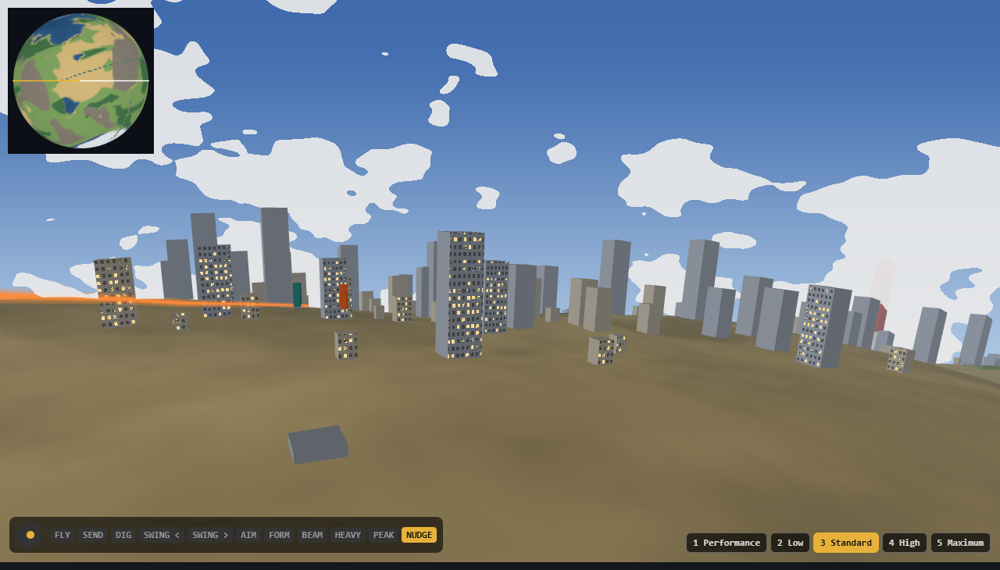

# Arena feel: eight pitches

Research & Prototyping, 2026-11-01, for Orb's order: "as playable, responsive, and fun as possible". Each idea makes the arena feel faster or more alive for little work. Game Design's feature map (`docs/design/rule-of-cool-map.md`) says what to build; these are tricks to lay over it, and none repeats a row there unless it says so.

**Build three for the first playable: the kick and coin turn, the press that answers in one frame, and flying into night. Add the low line as soon as a rule for towers exists.** Numbers 1 and 2 are playable now in `research/rule-of-cool/feel.html`, with a pad. Everything else is unbuilt, and its costs are my estimates. **Nobody has played any of it,** so these are bets on feel until Orb has.

| # | Pitch | What it buys | Kind | Cost | First playable? |
| ---: | :--- | :--- | :--- | :--- | :--- |
| **1** | **The low line** | Speed, for no extra speed | Sim, small; view | S to M | **Next,** once towers have a rule |
| **2** | **The kick and the coin turn** | Response | Sim, small | S | **Yes** |
| 3 | The press answers in one frame | Response | View | S | **Yes** |
| 4 | Fly into night | Crossing a planet | View | S | **Yes** |
| 5 | The shock leaves during the freeze | Weight of a big hit | View | S to M | No, soon after |
| 6 | A speedometer in your hands | Speed | View (pad) | S | Soon after, it's Controls' existing row |
| 7 | The cloud scar | The world remembers you | View | M | No |
| 8 | Aim the send in the freeze | Agency at the peak | Sim, small | S to M | No, with the meteor |

**S** is one director's window, **M** two or three directors with a park each, as Game Design uses them.

## 1. The low line (playable)

**What the player notices.** Flat out, the fighter drops to skim the land, rising over a ridge just as it arrives and falling away behind it. Towers and trees whip past. Top speed is the same, and it feels far faster.

**How it works.** How fast something seems to move is its speed over its distance from you, so halving the height doubles the rush at no cost. Three parts, all in the page:

- **A height that looks ahead.** He targets the highest of three ground reads, up to 0.14 s ahead, plus 140 units. He climbs fast and sinks slowly, so it rides rather than rattles.
- **A wider lens as he speeds up,** 15° to 26° half-angle, with the fighter kept the same size. Near things rush and the horizon stays put.
- **A camera that looks ahead,** 18% of the view, so the speed is toward something.

**Measured in the page, top speed 10,240:**

| | Today's proto | Low line |
| :--- | ---: | ---: |
| Height over the land, mean of 30 s | 420 | **354** (lowest 140, highest 1,119 over mountains) |
| The land crossing the view | 0.65 views a second | **1.85** |
| Tile gaps, all five levels | | **0** |

**That 1.85 flatters it.** Most of the jump is the view's width: 5,500 against the proto's 15,700, and the game's own floor is already 4,200. **So in the game, the height, lens and look-ahead are what's new; the width isn't.**

**Cost and what it needs.**

- **Towers are the blocker.** At 140 he's below every roof, and the page flies straight through them. In the game that's a crash or a smash at 10,000 u/s. The cheap rule: over a place, the height reads roofs as well as ground, so he hops the skyline. Game Design's.
- **The stick must win.** In the game the left stick also moves him up and down (`fighter.gd`: `f.vy`), so this can only be a pull toward the line while the stick is level. That keeps Game Design's §13 rule: "a player holding a direction" isn't overruled.
- **The height is sim state,** so it's hashed and goes through the rollback gates. Three bake reads a tick are about the cheapest ground reads there are, and I haven't timed them.
- **The lens is a look-gate question.** Orb praised "no distortion" on the true globe, and at 34° towers leaned visibly at the frame's edges, so I backed off to 26°. It's a slider, and Orb's eye decides.
- **Not the flight lines in Game Design's §1:** those are view-only ribbons and "move no fighter". This moves him, so it needs its own ruling.

**How to test.** Fly the same route with View on and off. QA's row: he's never under the ground, and vertical speed stays under a limit so it doesn't rattle.

## 2. The kick and the coin turn (playable)

**What the player notices.** He leaves on the press. A stick flip at full speed plants him for a beat, with dust and a thump in the pad, and he's gone the other way at full speed.

**How it works.** The game's law is one lag toward the stick. That's why it feels floaty: speed takes a third of a second to arrive, and a reversal slides through zero with no moment to it.

- **The kick:** out of a standing start, speed goes to 135% of top in a couple of ticks, holds for 8, then eases to top by tick 36. It's the same shape as `fight-feel.md` §1's launch kick, applied to his own flight.
- **The coin turn:** a flip at more than half speed brakes hard for 5 ticks, plants for 3 with a small hop, then kicks the other way.

**Measured in the page, ticks at 60 a second:**

| | Today's proto | The game's law, by arithmetic | Kick and coin turn |
| :--- | ---: | ---: | ---: |
| Standstill to 95% of top speed | 18 | 26 | **2** |
| Full speed one way to 95% the other | 22 | 32 | **9** |

**Cost.** A small change to `flightSpeed`'s use at `fighter.gd:638`, with a few numbers in data, behind a switch. It adds two fields to the hash. It changes every flat-out chase, so QA reads escapes and catches, and the flee's balance moves. Reach and catching are the risk: an instant 135% may be too good a getaway, and limiting it by ki or a short cooldown is the first lever.

**How to test.** Menu button on and off, flying back and forth. QA's rows: escapes and catches a match stay inside their bands; a masher flipping the stick gains nothing (the plant is the price).

## 3. The press answers in one frame

**What the player notices.** Every press does something the instant it's pressed, even when the blow lands 10 ticks later. The game stops feeling like it's waiting.

**How it works.** A press starts a wind-up in the sim, and wind-ups are long on purpose. The view reads the raw press and answers on that frame, with nothing that changes the fight: the body starts its first frames of anticipation, a 1% push of the camera eased in over a few ticks, a low hum in the pad, and the first sound of the whoosh. If the sim refuses the press, the anticipation just settles back. Online, this needs no round trip, since nothing's being predicted.

**Cost.** S, view only. It touches Animation, Camera, Audio and Controls' cue mapper, each by a line or two. The danger is a tell: anticipation on a press the sim then refuses misleads the player. So keep it small and only on presses the sim's own rules would accept, which the input layer can already read.

**How to test.** Record the screen and pad at high speed and count frames from press to first change, today against this. The answer should drop from wind-up start to 1 frame plus the browser's own delay. Then Orb's hands.

## 4. Fly into night

**What the player notices.** You fly flat out for 10 seconds and the sun goes down. City windows come on. Keep going and it's dawn on the other side. No meter or map could say "you crossed a planet" as plainly.

**How it works.** The sun is fixed in planet coordinates instead of following the camera. The ground, sky and water take one more dot product, and the windows' glow reads the same term. Proto v2 already has a planet-fixed sun switch (`P.sun`), with ambient too high to get dark. A lap is 15 s flat out, so night is 4 to 8 s away from anywhere. At the meteor's width, the terminator lies across the globe, which should be the best shot in the game.

**Cost.** S, one term in Rendering's ground and sky, and it passes the look gate only if the night stays readable. **Fighters must stay clear at night:** their auras and rim light need to carry them, which is Art's and VFX's. It's a very slow change, so I expect nothing from the flash analyser, though nobody has read it. Where a match starts needs a rule: start in daylight, and Game Design can say whether the fight's own bearing should care.

**How to test.** Fly a lap in proto v2 with ambient lowered. Orb judges whether it reads as crossing, and Art judges the fighters at night.

## 5. The shock leaves during the freeze

**What the player notices.** On a planet-sized hit, the fighters hold dead still for the hit-stop, while the blow's force is seen leaving them: a ring runs out through the land and clouds, and arrives somewhere far off as the freeze ends.

**How it works.** The freeze is what a hit-stop already does, in `data/fight/hitstop.json`, so this adds no pause and stays inside Game Design's budget. **It isn't slow motion, which Orb passed on.** The ground shader gets one uniform per impact, a centre and a time, and raises a small travelling ring in its vertices. It's zero near the fighters so their feet stay put, and the clouds get the same term. Tier 3 and up, as feature 12's "the world reacts".

**Cost.** S to M: Rendering's and VFX's. A moving ring is a new case for the flash analyser, and Legal needs its reading before anything public. At most two at once.

**How to test.** A side-by-side of the launch with it on and off, through the look gate. QA's row: never over a fighter.

## 6. A speedometer in your hands

**What the player notices.** Flying low, the pad ticks with what you pass: a light pulse per building, a rough purr over rock, smooth over water. Faster means more ticks, and the rate tells you your speed with your eyes on the fight.

**How it works.** Controls' cue mapper already has eight haptic kinds. This feeds it from what the view already knows is passing: the nearest building's bucket, and the biome under him. Game Design's row 6, "the pad keeps the beat", names flat-out flight; this gives it a texture.

**Cost.** S. Pad rumble only works where the browser and pad allow it, so it can never be the only cue (rule 6). It needs Orb's usual caution about rumble: sparing, chunky, not constant.

**How to test.** In `feel.html` next, since a real pad is already there.

## 7. The cloud scar

**What the player notices.** A meteor or a flat-out flight through the clouds leaves a clean cut in the cloud deck that stays for the match. From the widest view, you can see where the fight has been.

**How it works.** The cloud shader reads a small texture of recent paths in planet coordinates, the same path store VFX's trail already keeps, and thins the clouds near it. Orb liked the minimap's trail for its sense of crossing; this is that trail written on the world.

**Cost.** M, mostly in keeping the texture cheap on the lower levels, where clouds may be off anyway. View only, so it can't affect a fight, though two players' views must agree only by being made from the same sim path.

**How to test.** Add to proto v2's clouds; Orb judges at the widest view. Performance reads the fill cost at Standard.

## 8. Aim the send in the freeze

**What the player notices.** At the peak of the biggest hit, during the 16-tick freeze, the right stick aims the send: which way, and how far along the planet. You choose which city he lands on, with a beat to do it in.

**How it works.** Game Design's meteor already has up to three landings a side, and the curve is a closed form of its landing, so choosing costs one evaluation. Read `rsAim` during the hit-stop and pick the candidate it points nearest. No marker shows the choice, as Orb's rule requires: the launcher's body and a small lean of the camera show it instead. **It uses a thumb that's otherwise idle at that moment,** which is what the new layout buys. It's a neat fit with pillar 2's "the player owns intent", and the director still scores the landings.

**Cost.** S to M: Encounter and Controls. It has to be confirmed ahead for online, and the freeze may be too short to read on some connections. Netcode's question. Never people (RL-213): the candidates already exclude them.

**How to test.** On the meteor in `proto-v2.html`, with the stick during the stop. QA's row: the choice is taken on most launches without shortening the freeze.

## Considered and left out

- **Slow motion on big hits:** Orb passed on it. Pitch 5 does the job with no slowing.
- **Motion blur or a speed-line overlay:** full-screen blur is rejected, and speed lines are already feature 11.
- **Slipstream behind a rival's burn:** fun, but Game Design's §1 rules that a flight line "gives no slipstream".
- **A catch at the apex:** already Game Design's row 7.

## What the page doesn't show

- It's a stand-in for the game: two bars on real ground, no fight, no collisions, and the proto's flight law, which is a little quicker than the game's.
- **No real pad has been tried.** I drove it with a scripted one, which proved the triggers, the View and Menu switches and the rumble calls, and nothing about how it feels. A wired pad on Chrome is what I'd expect to work, and rumble depends on the browser.
- The kick's and turn's numbers are first guesses.
